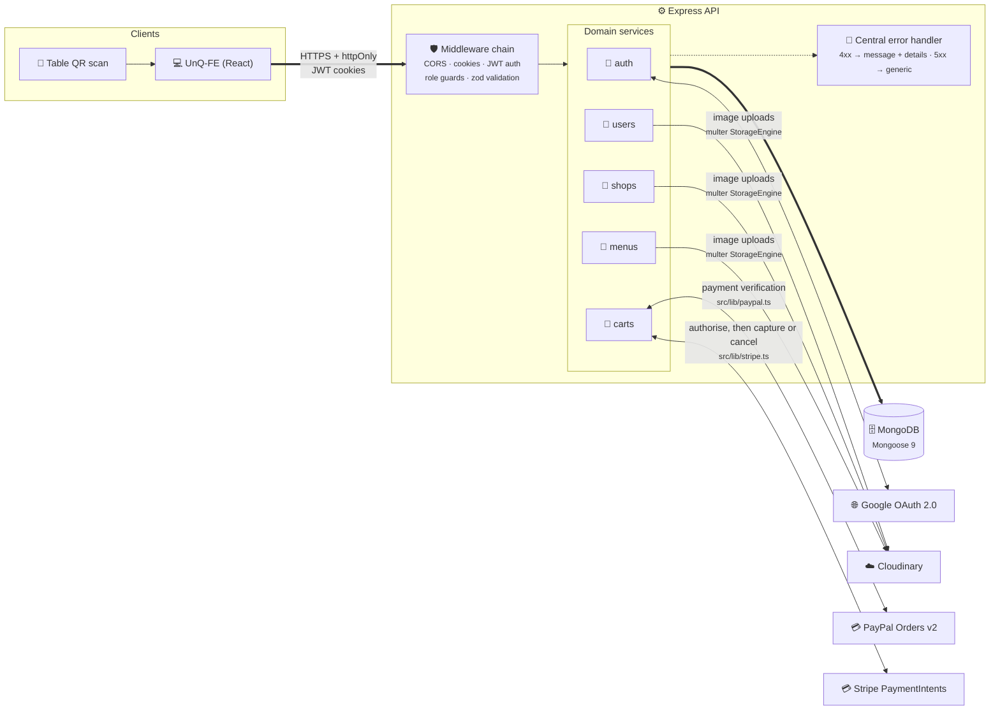

<div id="top"></div>

<!-- PROJECT LOGO -->
<br />
<div align="center">
  <!-- <a href="https://github.com/Nando-C/UnQ-BE">
    
  </a> -->

<h3 align="center">UnQ — Back-End</h3>

  <p align="center">
    QR-code-based table ordering for bars & restaurants — scan, order, split the bill.
    <br />
    <br />
    <a href="https://github.com/Nando-C/UnQ-FE">Front-End Repo</a>
    ·
    <a href="https://github.com/Nando-C/UnQ-FE#try-customer-interface">View Demo</a>
  </p>

  <p align="center">
    =20.19">
    
    
    
    
  </p>
</div>

<!-- TABLE OF CONTENTS -->
<details>
  <summary>Table of Contents</summary>
  <ol>
    <li>
      <a href="#about-the-project">About The Project</a>
      <ul>
        <li><a href="#built-with">Built With</a></li>
      </ul>
    </li>
    <li><a href="#features">Features</a></li>
    <li><a href="#architecture">Architecture</a></li>
    <li><a href="#setup">Setup</a></li>
    <li><a href="#testing">Testing</a></li>
    <li><a href="#models">Models</a>
     <ul>
        <li><a href="#user">User</a></li>
        <li><a href="#shop">Shop</a></li>
        <li><a href="#menu">Menu</a></li>
        <li><a href="#cart">Cart</a></li>
      </ul>
    </li>
    <li><a href="#rest-api">REST API</a>
     <ul>
        <li><a href="#authorization">Authorization</a></li>
        <li><a href="#users">Users</a></li>
        <li><a href="#shops">Shops</a></li>
        <li><a href="#carts">Carts</a></li>
      </ul>
    </li>
    <li><a href="#contact">Contact</a></li>
  </ol>
</details>

<!-- ABOUT THE PROJECT -->

## About The Project

UnQ lets customers scan a QR code on their table, browse a shop's menu, place an order, and split the bill per item with the rest of the table — no app install, no waiting for a waiter to take the order. On the other side, shop managers run their shop's profile, tables, and menu from the same API.

This is the Back-End of my solo capstone project for Strive School's Full-Stack program, built concept-to-deployment in 5 weeks — designing the data model, the REST API, and the authentication/authorization layer, and implementing both the Front-End and Back-End from scratch in that time.

**Recently modernized (2026):** the codebase went through a staged security and quality pass — mass-assignment whitelisting, working refresh-token rotation, short-lived (15m) access tokens, sanitized error responses, `zod` request validation on every mutating endpoint, an integration test suite (Jest + Supertest + an in-memory MongoDB), ESLint, and a dependency refresh that brought `npm audit` to 0 findings.

You can find the Front-End repo of this project in the following link, where more information about the use of this app is shared: [UnQ's Front-End](https://github.com/Nando-C/UnQ-FE)

<p align="right">(<a href="#top">back to top</a>)</p>

### Built With

- [TypeScript](https://typescriptlang.org/)
- [Node.js](https://nodejs.org/)
- [Express.js](https://expressjs.com/)
- [MongoDB](https://www.mongodb.com/) + [Mongoose](https://mongoosejs.com/)
- [Zod](https://zod.dev/)
- [express-rate-limit](https://express-rate-limit.mintlify.app/)
- [Passport.js](https://www.passportjs.org/) (Google OAuth 2.0)
- [Cloudinary](https://cloudinary.com)
- [Stripe](https://stripe.com) (the official `stripe` client)
- [Jest](https://jestjs.io/) + [Supertest](https://github.com/ladjs/supertest) + [mongodb-memory-server](https://github.com/typegoose/mongodb-memory-server)

<p align="right">(<a href="#top">back to top</a>)</p>

## Features

- JWT authentication in `httpOnly` cookies, with refresh-token rotation and short-lived (15m) access tokens
- Google OAuth login (Passport), issuing the same cookie pair as email/password login
- Role-based access control (`customer` vs. `shopMg`), enforced per-route
- Shop, table, and menu management for shop managers
- Per-table QR code URLs, generated on table creation
- Shared table carts with per-item bill splitting between multiple customers at the same table
- Cloudinary image uploads for user avatars, shop covers, and menu item photos (images only, up to 5 MB; permissions checked before anything is uploaded, and a replaced image is deleted)
- Request validation (`zod`) on every mutating endpoint, with a consistent `{ message, details }` error shape
- Server-side PayPal checkout: the API creates the order for the exact amount due (database prices, bound to cart + payer via `custom_id`) and captures it only after reserving the units — a conflict discovered before capture costs the buyer nothing, and one discovered in the window after capture is refunded automatically. Order-id replay protection and multi-payer concurrency safety throughout; the API never takes the client's word that a payment happened
- Card payments (Apple Pay and Google Pay included) through Stripe, beside PayPal, with the same guarantee: the diner's card is only authorised, the API re-checks the cart and then captures, or cancels the authorisation so nothing is charged. One finisher at a time per payment (the diner's request, Stripe's webhook, or a sweep every 2 minutes), so an authorised payment the diner walked away from is still finished, and they're told the outcome on their next visit to the table. Money Stripe won't give back (a refund that failed for good) becomes a pay-back on the table, flagged to the shop's managers until one marks it done

<p align="right">(<a href="#top">back to top</a>)</p>

## Architecture



The API is organized service-per-domain: each domain under `src/services/<name>/` owns its `routes.ts`, `model.ts`, `controllers.ts`, and `schemas.ts` (zod). Shared concerns live outside the services:

- `src/services/auth/middlewares.ts` — `JWTAuthMiddleware` (verifies the access-token cookie), `adminOnly` / `isShopManager` (role guards)
- `src/middlewares/validate.ts` — generic `validate(schema)` middleware, runs after auth/role checks and before the controller
- `src/lib/passwordLimit.ts` and `src/middlewares/rateLimits.ts` — the wrong-password and cart-change rate limits (see [REST API](#rest-api))
- `src/errorMiddlewares.ts` — single error-handling exit point: 4xx errors return `{ message, details? }`, everything else is logged and returns a generic 500
- `src/settings/` — CORS whitelist and a custom Cloudinary multer `StorageEngine`
- `src/lib/payments.ts` — refunds and payment checks for either provider; `src/lib/paypal.ts` and `src/lib/stripe.ts` are the providers' clients

```
src/
├── index.ts              # env load, mongoose connect, listen
├── server.ts              # express app (exported, not listening — used directly by tests)
├── errorMiddlewares.ts
├── middlewares/
│   ├── rateLimits.ts
│   └── validate.ts
├── settings/
│   ├── cors.ts
│   └── cloudinary.ts
├── services/
│   ├── auth/               # register, login, refresh, logout, Google OAuth
│   ├── users/               # profile + avatar
│   ├── shops/               # shop CRUD + tables
│   ├── menus/                # menu items
│   ├── carts/                # cart, split-bill flows, checkout (stripeFinish.ts: finishing card payments)
│   └── payments/             # Stripe's webhook; pay-backs (money staff give a diner back by hand)
├── typings/                # shared TS types/interfaces
└── tests/                  # Jest integration suite
```

**Auth flow:** login/register/Google OAuth all issue the same pair of `httpOnly` cookies — a 15-minute access token and a 4-week refresh token. `POST /auth/refreshToken` verifies the refresh token against the one stored on the user document and rotates both cookies; a refresh token that's expired, invalid, or was replaced a while ago (a sign-in on another device, a logout, a password change) is rejected with a `401` and both cookies are cleared, so that device carries on as a guest. One replaced within the last minute gets a `401` with the cookies left alone and `reason: "superseded"` in the body: another tab in the same browser has just refreshed, and they're its new ones, so the request that needed the refresh can be sent again. Each account holds one refresh token, so signing in on one device ends the session on the others. Google OAuth runs through Passport with `session: false` — no server-side session, just the same JWT cookie pair on redirect. A Google sign-in whose verified email matches an existing account links to it and removes that account's password (nothing proved whoever set it owned the address), so from then on it signs in with Google. A new Google account takes its name from Google and has no surname when Google gives no family name. Emails are stored trimmed and lowercase, and match however they're capitalised.

<p align="right">(<a href="#top">back to top</a>)</p>

## Setup

### Getting Started

1. Copy `.env.example` to `.env` and fill in the required environment variables:
   ```bash
   cp .env.example .env
   ```

2. Install dependencies:
   ```bash
   npm install
   ```

3. To receive Stripe's webhook events locally, forward them to the dev server with the [Stripe CLI](https://docs.stripe.com/stripe-cli) (its signing secret, from `stripe listen --print-secret`, is `STRIPE_WEBHOOK_SECRET`; it stays the same for this machine and account):
   ```bash
   stripe listen \
     --events payment_intent.amount_capturable_updated,payment_intent.succeeded,payment_intent.payment_failed,payment_intent.canceled,refund.failed \
     --forward-to localhost:3001/payments/stripe/webhook
   ```
   Recent Stripe CLI versions require `--events`; these are the five the API acts on.
   Deployed, the endpoint is added in Stripe's dashboard (Developers → Webhooks) with the events `payment_intent.amount_capturable_updated`, `payment_intent.succeeded`, `payment_intent.payment_failed`, `payment_intent.canceled` and `refund.failed`, and its signing secret set on the host before the API deploys (the API won't start without it).

Configuration is centralised in `src/settings/env.ts` — a single zod schema parsed once at import time, exported as a typed frozen object. No other file reads `process.env`.

### Environment Variables

Copy `.env.example` to `.env` and fill it in. Configuration is validated at boot by `src/settings/env.ts`: if anything required is missing or empty, the server prints **every** problem at once (variable names only, never values) and exits non-zero rather than starting in a half-working state.

| Variable | Description |
|---|---|
| `PORT` | Port the server listens on |
| `PUBLIC_API_URL` | Where a **browser** reaches this API — the front-end's proxied prefix (e.g. `https://un-q.vercel.app/api`) when the front-end proxies the API through its own origin, not this server's host. Google's OAuth callback is built from it |
| `FRONTEND_URL` | Front-end URL used for redirects and generated table QR URLs (production) |
| `FRONTEND_DEV_URL` | Front-end URL used as a local-dev fallback when `FRONTEND_URL` isn't set |
| `FRONTEND_PROD_URL` | Front-end production URL, added to the CORS whitelist |
| `MONGO_CONNECTION` | MongoDB connection string |
| `JWT_SECRET` | Signing secret for access tokens |
| `JWT_REFRESH_SECRET` | Signing secret for refresh tokens |
| `GOOGLE_CLIENT_ID` | Google OAuth client ID |
| `GOOGLE_SECRET` | Google OAuth client secret |
| `CLOUDINARY_URL` | Cloudinary account URL (auto-configures the SDK) |
| `PAYPAL_CLIENT_ID` | PayPal client ID (used for server-side order verification) |
| `PAYPAL_CLIENT_SECRET` | PayPal client secret (used for server-side order verification) |
| `PAYPAL_API_BASE` | PayPal API base URL — defaults to the sandbox (`https://api-m.sandbox.paypal.com`) when unset |
| `STRIPE_SECRET_KEY` | Stripe secret key: `sk_test_…` for test mode, `sk_live_…` for live (the server logs which at boot) |
| `STRIPE_WEBHOOK_SECRET` | Signing secret (`whsec_…`) of the Stripe webhook endpoint; locally, `stripe listen --print-secret` |
| `PASSWORD_FAILS_PER_ACCOUNT` | Wrong passwords allowed per account in 15 minutes (default 10) |
| `CART_EDITS_PER_MINUTE` | Cart changes allowed per diner a minute (default 120) |
| `BCRYPT_ROUNDS` | bcrypt cost for stored passwords, 10–13 (default 10; lower refused except inside the test suite, which uses 4) |

### Dependency override

`package.json`'s `overrides` gives `@istanbuljs/load-nyc-config` (pulled in by Jest's coverage tooling) `js-yaml` 4 instead of 3. js-yaml 3 depends on `argparse@1` → `sprintf-js`, which has an open advisory (GHSA-hp3w-g68c-fv3c) with no fixed version. That module only calls `js-yaml`'s `load()`, which works the same in 4. Remove the override once `@istanbuljs/load-nyc-config` itself depends on js-yaml 4 (check with `npm ls js-yaml`).

### Available Scripts

| Script | Description |
|---|---|
| `npm run dev` | Dev server with hot reload |
| `npm run build` | Compile TypeScript to `./build` |
| `npm start` | Run the compiled build |
| `npm test` | Run the Jest integration suite |
| `npm run lint` | Run ESLint on the `src/` directory |
| `npx tsx src/scripts/syncOrders.ts` | Write or bring up to date every payment's order (backfill, and repair after "Order not written"); safe to rerun |
| `npx tsx src/scripts/finishStripeCheckouts.ts` | Finish the card payments left unfinished, as the server does every 2 minutes; safe to run beside it |

<p align="right">(<a href="#top">back to top</a>)</p>

## Testing

The API is covered by a Jest + Supertest integration suite running against an in-memory MongoDB (`mongodb-memory-server`) — no external database or network calls required. It covers the full auth flow including refresh-token rotation and role-escalation attempts, authorization boundaries between users/shops/carts (e.g. a customer can't manage a shop, a user can't read another user's cart), the cart and split-bill flows, table QR-code integrity across renames, and mocked upload wiring for the Cloudinary routes. PayPal is mocked at its client, and Stripe by an in-memory fake (`src/tests/fakeStripe.ts`) that changes payments the way Stripe does, so the card checkout's races (the diner's request against the webhook and the sweep, captures whose outcome is unknown, refunds after a lost race) are played out without the network. Run it with:

```bash
npm test
```

To try card payments by hand, use a Stripe test key (`sk_test_…`) and Stripe's test cards, with any future expiry date and any CVC: `4242 4242 4242 4242` pays, `4000 0025 0000 3155` asks for the bank's check first, and `4000 0000 0000 0002` is declined.

<p align="right">(<a href="#top">back to top</a>)</p>

<!-- MODELS EXAMPLES -->

## Models

I have used MongoDB with Mongoose to model the data for this application, creating five main models as shown below.

### User

```js
User Model:
    {
        name: string,
        surname: string, // may be absent on a Google account
        email: string,
        password: string,
        avatar: string,
        role: {
            type: String,
            enum: ["customer", "shopMg"],
        },
        refreshToken: string,
        googleId: string,
    }
```

<p align="right">(<a href="#top">back to top</a>)</p>

### Shop

```js
Shop Model:
    {
        name: string,
        cover: string,
        bio: string,
        open_times: string,
        phone: string, // as typed, e.g. "0161 496 0000"; "" clears it
        web_URL: string,
        shopMg: {
            type: ObjectId,
            ref: "User",
        },
        tables: [
            {
                name: string,
                Qr_Url: string,
            },
        ],
        menu: [
            {
                type: ObjectId,
                ref: "MenuItem",
            },
        ],
    }
```

<p align="right">(<a href="#top">back to top</a>)</p>

### Menu

```js
MenuItem Model:
    {
        name: string,
        image: string,
        short_description: string,
        description: string,
        price: number,
        available: boolean,
        category: {
            type: String,
            enum: ["food", "drinks"],
        },
    }
```

<p align="right">(<a href="#top">back to top</a>)</p>

### Cart

```js
Cart Model:
    {
        userId: {
            type: ObjectId,
            ref: "User",
        },
        shopId: {
            type: ObjectId,
            ref: "Shop",
        },
        tableId: string,
        status: {
            type: String,
            enum: ["open", "splitted", "closed"],
        },
        items: [
            {
                menuId: {
                    type: ObjectId,
                    ref: "Menu",
                },
                qty: number,
                qtyPayed: number,
            }
        ],
        split: [
            {
                userId: {
                    type: ObjectId,
                    ref: "User",
                },
                menuId: {
                    type: ObjectId,
                    ref: "Menu",
                },
                qty: number,
                splitStatus: {
                    type: String,
                    enum: ["open", "closed"],
                },
                unitPrice: number, // once paid: the price charged per unit
                paidAt: Date,      // once paid
            }
        ],
        // Manager-only: refunds against the payments, pending → completed | failed.
        refunds: [{ paymentId: ObjectId, lines: [{ menuId, name, qty }], amount: number, currency: string,
                    status: "pending" | "completed" | "failed", providerRefundId?: string, failureReason?: string,
                    byUserId: ObjectId, at: Date,
                    // Why (absent on older refunds); a note only with "other".
                    reason?: "unavailable" | "wrong_item" | "quality" | "long_wait" | "paid_by_mistake" | "changed_mind" | "other",
                    reasonNote?: string }],
        // Notes to the diners about a manager's change. Diners get the table-wide
        // ones and their own, from the last 2 hours (at most 5).
        notices: [{ at: Date, forUserId?: ObjectId, message: string }],
        // Manager-only: what managers did to this cart (no byUserId: the server
        // did it, e.g. finished a card payment the diner left).
        managerLog: [{ at: Date, byUserId?: ObjectId, action: string, details: string }],
        // Manager-only: never included in a diner's cart response.
        // Provider-neutral, so other payment providers can record the same way.
        payments: [
            {
                provider: "paypal" | "stripe",
                status: "completed" | "pending" | "failed", // pending: taken, not yet confirmed (see payments/:paymentId/check)
                providerCheckoutId: string, // PayPal: the order id; Stripe: the PaymentIntent (pi_…)
                providerPaymentId: string,  // what a refund is made against: PayPal's capture id, Stripe's charge (ch_…)
                currency: string,           // "GBP"
                userId: ObjectId,   // the payer
                paidAt: Date,
                amount: number,     // captured, in `currency`
                lines: [
                    { menuId: ObjectId, name: string, qty: number, unitPrice: number, refundedQty: number,
                      category?: string }, // the item's category when paid (absent on older lines)
                ],
            }
        ],
    }
```

### Card payment (StripeCheckout)

One per Stripe PaymentIntent the API created, written as it's created and kept as an audit trail. It says who is finishing the payment (one at a time: the diner's capture request, the webhook or the sweep, each claiming it with a token and a 2-minute lease) and how it ended. Diners never see it; it's how they're told an outcome their own request didn't answer (see the carts' notices).

```js
StripeCheckout Model:
    {
        _id: string,              // the PaymentIntent id
        cartId: ObjectId, tableId: string, userId: ObjectId, // who it was made for
        shopId?: ObjectId,        // the table's shop when created (older records: found by the table), for its pay-back once the cart is gone
        amount: number,           // in pence, as created
        state: "open" | "finishing" | "releasing" | "recorded" | "released" | "refunded" | "refundFailed",
        token?: string, leaseUntil?: Date, // the current holder's claim
        checkedAt?: Date,         // the sweep's last look at an open one
        confirmed: boolean,       // the diner got past entering their card
        finishedAt?: Date, paymentStatus?: "completed" | "pending" | "failed",
        answered?: string,        // the outcome the diner's own request gave them ("recorded:completed", "released", …);
        answeredBy?: string[],    // the ids of the requests that gave it; a notice is shown while the outcome differs from `answered`
        status?: number, message?: string, // the answer given for a released or refunded one
        refunding?: boolean,      // a finisher decided to refund it (a race lost after the capture): later ones only complete the refund
        refundId?: string,        // the refund a refunded one ended with; if Stripe reports it failed, the record reopens and it's refunded again,
                                  // or becomes refundFailed (handed to staff) when a new refund would fail too or it already failed 3 times
        refundFailures?: number,  // how many of its refunds Stripe reported failed
        refundRefusedSince?: Date, // when Stripe first refused its refund outright (retried every 30 minutes; handed to staff a day later)
        staffToldAt?: Date,       // a refundFailed one: when staff were told on its cart (the sweep retries until then)
        refundOwed?: number,      // a refundFailed one: in pence, what was still taken (staff may have refunded part by hand)
        disputed?: boolean,       // a refundFailed one: Stripe refused it for the diner's open dispute, which pays them back
    }
```

### Pay-back (Payback)

Money staff must give a diner back another way, because Stripe won't: one per card payment handed to staff (`refundRefused`: the API's own refund of a payment it couldn't record failed for good, see `refund.failed` under [Payments](#payments)), and one per manager's card refund that Stripe accepted and then failed (`refundFailed`). Kept apart from the cart, which may be closed and deleted by then. Shown on the table's sheet (the owed ones, and those marked done in the last 30 days), flagged on the table until a manager marks it done, and the shop can't be deleted while one is owed. Diners never see it.

```js
Payback Model:
    {
        _id: ObjectId,
        shopId: ObjectId, tableId: string, cartId: ObjectId, // where it was owed (the cart may be gone)
        kind: "refundRefused" | "refundFailed",
        userId: ObjectId,         // the diner to pay back
        amount: number,           // owed, in pounds (as the cart's money fields)
        currency: string,         // "GBP"
        paymentIntentId?: string, // Stripe's payment, to find it in the dashboard
        refundId?: ObjectId,      // a refundFailed one: the cart's refund record
        paymentAmount?: number,   // a refundFailed one: the whole payment (a dispute is of all of it)
        disputed?: boolean,       // Stripe refused it for the diner's open dispute: their bank returns the money, staff don't
        owed?: boolean,           // true until marked done, then absent
        at: Date,
        doneAt?: Date, doneByUserId?: ObjectId, doneAs?: "paidBack" | "handled" | "checked", // who marked it, when, and as what
    }
```

### Order

One per cart payment, the sales record the reports read (no route serves it yet). Rebuilt from the cart after every save that changes the payment or a refund of it, so the cart stays the source of truth; an order outlives its cart, table, menu items and shop. A sync that fails after the money moved is logged ("Order not written") and never fails the request: `npx tsx src/scripts/syncOrders.ts` puts it right.

```js
Order Model:
    {
        paymentId: ObjectId,      // the cart payment's _id (unique: one order per payment)
        cartId: ObjectId,         // a table visit is the orders sharing it
        cartOpenedAt: Date,
        cartVersion: number,      // the cart's __v it was built from (an older one never overwrites it)
        shopId: ObjectId,
        tableId: string,
        tableName: string,        // as it was when first written
        payerId: ObjectId,        // counted, never shown
        status: "completed" | "pending" | "failed", // the payment's
        paidAt: Date,
        currency: string,
        amount: number,
        provider: "paypal" | "stripe",
        providerCheckoutId: string,
        providerPaymentId: string,
        lines: [{ menuId, name, category: string | null, unitPrice, qty, refundedQty }],
        refunds: [{ refundId, status, at: Date, amount, lines: [{ menuId, name, qty }], reason?, reasonNote? }],
    }
```

<p align="right">(<a href="#top">back to top</a>)</p>

## REST API

These are the available endpoints created for this application. Every mutating request is validated (`zod`) and responds `400 { message: "Validation failed", details: [...] }` on bad input.

**Rate limits.** Over a limit, a request gets `429 { message }`. Limits count per account, not per IP: behind the front-end's proxy the server can't tell visitors' addresses apart reliably.
- Wrong passwords: 10 per account in 15 minutes (`PASSWORD_FAILS_PER_ACCOUNT`), counted together at `POST /auth/login` (`401`) and wherever the current password is confirmed (`PUT /users/me` changing the email or password, `DELETE /users/me`; `403`). Over it, every password check for that account answers `429` until the 15 minutes are up, the right password included; other changes to the account still work. Only real comparisons count: an email with no account, or a Google-only one, isn't counted.
- A diner's cart changes (`addItem`, `removeItem`, `deleteItem` and the three split routes): 120 a minute per user (`CART_EDITS_PER_MINUTE`). Checkout is never limited.
- Counts are kept in the server's memory: they restart with it, and several servers would need a shared store.

### Authorization

- [ 'POST' ]

  baseURL-api/auth/refreshToken

- [ 'POST' ]

  baseURL-api/auth/register

- [ 'POST' ]

  baseURL-api/auth/login

- [ 'GET' ]

  baseURL-api/auth/logout

- [ 'GET' ]

  baseURL-api/auth/googleLogin

- [ 'GET' ]

  baseURL-api/auth/googleRedirect

<p align="right">(<a href="#top">back to top</a>)</p>

### Users

- [ 'GET', 'PUT', 'DELETE' ]

  baseURL-api/users/me

  The user carries `hasPassword` (false for a Google-only account). `PUT` body: any of `{ name, surname, email, password, currentPassword }`. Changing the email or password of an account that has a password needs `currentPassword` (`400` without it, `403` when it's wrong), and so does `DELETE` (body `{ currentPassword }`), which also ends the session (the cookies are cleared) and is refused with `409` while the user still manages a shop (delete the shops first). A Google-only account can't be given a password (`403`). A new password ends the account's other sessions and sets fresh cookies for this one. `409` for an email another account has.

- [ 'PUT' ]

  baseURL-api/users/me/avatar

<p align="right">(<a href="#top">back to top</a>)</p>

### Shops

- [ 'POST', 'GET' ]

  baseURL-api/shops

- [ 'GET' ]

  baseURL-api/shops/browse?q=&cursor=&limit=

  A page of shops for the home page, oldest first: `{ shops: [{ _id, name, bio, cover }], next }`. `next` is the `cursor` for the following page, `null` on the last. `limit` 1–50 (default 20; an empty parameter counts as absent). With `q` (up to 100 characters), only shops whose name or bio contains it, or whose menu has an item whose name contains it, case aside. `400` (`details`, as for a bad body) for a query it can't read. `GET /shops` still returns every shop with its menu.

- [ 'GET' ]

  baseURL-api/shops/me

  The manager's shops. Each also carries `deletedTables: [{ _id, name, deletedAt, needsAttention?, recentCartsUntil? }]`, the tables they deleted; `needsAttention: true` while one still has an open cart, a payment or refund `pending` at its provider, or a diner still to be paid back (a pay-back owed), and `recentCartsUntil` (a date) while its carts route still lists a closed cart there: a day after the latest one last changed. The public shop routes leave it out.

- [ 'GET', 'PUT', 'DELETE' ]

  baseURL-api/shops/:shopId

  `DELETE` deletes the shop with its menu items, its carts and its pay-backs. `409` while a table has an open cart, while a payment or refund of the shop is still `pending` at its provider (the message names the table to check it at, and the provider), while a card payment is still being finished (authorised and not yet recorded or released, or handed to staff but not yet shown; one nobody confirmed holds nothing and doesn't count: "A card payment at Table X is still being finished — try again shortly", or, for the API's own refund Stripe refused for now, "A card refund at Table X is being retried at Stripe (every 30 minutes, for up to a day) — try again later"), while a diner is still to be paid back ("A diner at Table X is still to be paid back — mark it done first"), for 30 days after a card refund of the shop last moved (a refund Stripe accepted can still fail that long after, and its pay-back needs the shop to be shown on: "A card refund at this shop on <date> can still fail at Stripe until <date>: the shop can be deleted from then"; the API's own refunds by when they last moved, a manager's by when it was made; card payments with no refund, refunds of PayPal payments, and refunds that have already failed and become pay-backs, don't hold it), or while a payment with its provider's payment id and something left to refund is on a closed cart changed in the last 24 hours (it's still on its table's carts, to be refunded). Accepted and logged as server errors (pay the diner back from Stripe's dashboard): a pay-back written in the moment between those checks and the deletion, and a card refund Stripe reports failed more than 30 days after it last moved, once the shop is gone.

- [ 'PUT' ]

  baseURL-api/shops/:shopId/cover

- [ 'POST', 'GET' ]

  baseURL-api/shops/:shopId/tables

- [ 'GET', 'PUT', 'DELETE' ]

  baseURL-api/shops/:shopId/tables/:tableId

  `PUT` `{ name }` renames the table, keeping its QR code; `400` if another of the shop's tables has that name, as on create. `DELETE` moves the table to the shop's `deletedTables`: its QR code takes no more orders and diners no longer see it, but its carts stay reachable through the carts route below. Its name can be used again. `409` while it has an open cart, or a payment or refund `pending` at its provider (named in the message).

- [ 'GET' ]

  baseURL-api/shops/:shopId/tables/status

  Shop managers only. One entry per table: `{ tableId, name, state, owed, paid, heldSince?, attention }`. `state` is `free`, `ordering` (items, nothing paid), `waitingToPay` (a diner has items selected) or `partlyPaid`. `attention` flags `soldOut` (unpaid units of an unavailable or deleted item), `staleSelection` (a selection held over 15 minutes), `duplicateCarts` (more than one open cart), `paymentPending` (a payment its provider hasn't confirmed: check it) and `payBack` (a diner at the table is still to be paid back: see the carts route's `paybacks`). `owed` leaves out sold-out units; `paid` counts units at the price they were paid at.

- [ 'GET' ]

  baseURL-api/shops/:shopId/tables/:tableId/carts

  Shop managers only. `{ open, recentlyClosed, paybacks }`: the table's open cart(s) and the carts closed in the last 24 hours, newest first, each with its payment records. Diners in selections and payments are shown as `{ _id, name }` (first name only). Works for a deleted table too, and also lists older closed carts with a payment or refund still `pending` at its provider, to be checked. `paybacks` are the table's [pay-backs](#pay-back-payback), owed or marked done in the last 30 days, newest first, whichever cart they came from (it may be gone): each as the model, with `userId` and `doneByUserId` as `{ _id, name }` (`null` for an account that's gone), and `recorded: true` on an owed `refundRefused` one whose payment a cart now shows as paid (it was recorded after being handed over: check the cart before paying it back).

- [ 'POST' ]

  baseURL-api/shops/:shopId/paybacks/:paybackId/done

  Shop managers only; no money moves. Body `{ as }`: `paidBack`, `handled` (a disputed one: the diner's bank returns the money, staff accept the dispute in Stripe's dashboard instead) or `checked` (a hand-over whose payment a cart shows as paid). `as` must be what the pay-back calls for now (a disputed one `handled`; a `refundRefused` one a cart shows as paid, `checked`; else `paidBack`): `409 "This pay-back changed: here it is again"` otherwise, so what's stored is what the manager saw. Answers `{ payback }` as the carts route lists it, with `doneAt`, `doneByUserId` and `doneAs` set and `owed` gone, and a `paybackDone` line on its cart's `managerLog` (without changing the cart's `updatedAt`; no line when the cart is gone). One already marked done answers as it was marked, whatever `as` was sent. `404` for a pay-back that isn't this shop's, `400` for another `as`.

- [ 'POST' ]

  baseURL-api/shops/:shopId/tables/:tableId/carts/:cartId/releaseSelection
  baseURL-api/shops/:shopId/tables/:tableId/carts/:cartId/removeItem
  baseURL-api/shops/:shopId/tables/:tableId/carts/:cartId/close
  baseURL-api/shops/:shopId/tables/:tableId/carts/:cartId/mergeInto

  Shop managers only; no money moves. `releaseSelection` `{ userId?, menuId? }` frees units held in open selections (everyone's, one diner's or one item's); `userId: null` means the diners whose account no longer exists. `removeItem` `{ menuId }` takes out all of an item's unpaid units, including those in diners' open selections (unlike the diner's bin, which leaves other diners' selections alone); a cart left with nothing ordered and nothing paid closes, so the table is free again. `close` drops every unpaid unit and open selection, keeps the paid ones, and closes the cart (a cart where nothing was ever paid is deleted, unless a payment settled on it meanwhile: then `409`); it answers `{ deleted, dropped, cart? }`. `mergeInto` moves an older duplicate open cart's unpaid units and selections into the table's newest one. Each leaves a note for the diners (`notices` in their cart responses: the table-wide ones and their own, from the last 2 hours) and an entry in the cart's `managerLog`. A concurrent change to the cart answers `409 The cart changed, please retry`. `close` and `mergeInto` answer `409` while a payment on the cart is `pending`. Deleting a table (or a shop) with an open cart is refused with `409` until it's closed.

- [ 'POST' ]

  baseURL-api/shops/:shopId/carts/:cartId/refunds

  Shop managers only; money moves. Body `{ paymentId, lines: [{ menuId, qty }], reason?, reasonNote? }`, `reason` one of `unavailable`, `wrong_item`, `quality`, `long_wait`, `paid_by_mistake`, `changed_mind`, `other`, with `reasonNote` (1–200 characters) required for `other` and refused otherwise (`400`); without a reason the refund is still made, with none recorded: refunds those units of one recorded payment, at the prices it charged, through the payment's provider (PayPal: a partial refund of its capture; Stripe: a refund of its charge, in pence; each with the refund's id as the idempotency key), and takes them out of the cart. Open or closed carts of the shop. A `pending` refund record is saved before the provider is asked, so the same units can't be refunded twice; it then becomes `completed` or `failed`. Answers `{ refund, cart }`; `400` for more than is left to refund, `409` for a payment with no recorded capture or charge (refund it from the provider's dashboard) or one that is `pending` or `failed`, `502` with the provider's reason when it refuses (nothing refunded; the record is `failed`), `502` also when the provider gives no clear answer (a timeout, a provider error, or an earlier request for it still in progress: the refund may have gone through, so the record stays `pending`: retry it), `500` if it went through but couldn't be recorded (the refund stays `pending`: retry it). The payer gets a note.

- [ 'POST' ]

  baseURL-api/shops/:shopId/carts/:cartId/refunds/:refundId/retry

  Shop managers only. Settles a `pending` refund. First asks the provider whether it already has it (PayPal: the refund is sent with `custom_id` = the refund's id and looked up on the order; Stripe: with the refund's id in its metadata, looked up through all of the payment's refunds); if so, records it as the provider says (`completed`, or `failed`). If not, sends it again under the same id, which the provider can't apply twice. Answers `{ refund, cart }` like the refund route, with the same `502`/`500` cases; `409` if the refund isn't `pending`, `502` if the provider can't be asked (still `pending`).

- [ 'POST' ]

  baseURL-api/shops/:shopId/carts/:cartId/payments/:paymentId/check

  Shop managers only. Asks the provider about a `pending` payment (one PayPal held for review at checkout, or a card payment Stripe was still processing). Confirmed: it becomes `completed`, and the cart closes if everything on it is paid. Declined or failed: it becomes `failed` and its units are unpaid again, back in the payer's selection (nothing was taken); the cart reopens if it had closed, and a second open cart on the table is flagged `duplicateCarts` for the manager to merge. A cart with a `pending` payment never closes on its own, even when every unit is paid. Answers `{ payment, cart }` and the payer is told: a note on the cart (PayPal), or a notice from the card payment's record (Stripe), which outlives the cart; `409` if the provider is still processing it (nothing changes) or it isn't `pending`, `502` if the provider can't be asked.

- [ 'POST', 'GET' ]

  baseURL-api/shops/:shopId/menu

- [ 'GET', 'PUT', 'DELETE' ]

  baseURL-api/shops/:shopId/menu/:itemId

  A menu item's `price` is in whole pence (at most 2 decimals; `400` otherwise). `DELETE` takes the item off the menu; it is kept, unavailable, so the carts that hold it still show its name (as sold out), and deleted with the shop.

- [ 'PUT' ]

  baseURL-api/shops/:shopId/menu/:itemId/img

<p align="right">(<a href="#top">back to top</a>)</p>

### Carts

**Sold-out items.** A menu item with `available: false` can't be added to a cart, newly claimed in a split, or paid for (the kitchen only acts on paid orders). Items that sell out while already in a cart stay there — cart responses carry `menuId.available` so the front-end can flag them — until a diner removes them; nothing is removed automatically and paid units are never touched.

- [ 'POST' ]

  baseURL-api/carts/:shopId/tables/:tableId/addItem

  `404` if the item isn't on this shop's menu, or `"Table Not Found!"` if the table isn't one of this shop's (e.g. deleted); `409` (`"This item is sold out"`) if it is unavailable.

- [ 'POST' ]

  baseURL-api/carts/:shopId/tables/:tableId/removeItem

  Rejects with `409` a decrease that would eat into units already paid for or held in an open split. A cart left with nothing is deleted (`204`), unless a manager acted on it or it holds payments or refunds: then it stays, closed.

- [ 'POST' ]

  baseURL-api/carts/:shopId/tables/:tableId/deleteItem

  Removes the item's **unpaid** units that no other diner has selected to pay for. The paid units stay (the payment record), and so do the units in other diners' open splits, with those splits; the caller's own selection goes with the units. A sold-out or deleted item goes whoever selected it, since nobody can pay for it. `409` (`"Someone at the table is paying for those"`) when there's nothing the caller may remove. If nothing unpaid remains, the cart is closed; if nothing is left at all, it is deleted and the answer is `204` (unless a manager acted on it or it holds payments or refunds: then it stays, closed).

- [ 'POST' ]

  baseURL-api/carts/:shopId/tables/:tableId/:cartId/addSplitItem

  Claims units of an item for the caller to pay. Rejects with `409` (`"This item is sold out"`) for an unavailable item, and with `409` (`"Not enough units left to split"`) when the request would push the units claimed by all diners' open splits, plus already-paid units, beyond the item quantity — so two customers can't both hold a split on the same unit.

- [ 'POST' ]

  baseURL-api/carts/:shopId/tables/:tableId/:cartId/decreaseSplitItem

- [ 'POST' ]

  baseURL-api/carts/:shopId/tables/:tableId/:cartId/removeSplitItem

- [ 'POST' ]

  baseURL-api/carts/tables/:tableId/:cartId/createCheckoutOrder

  Server-side checkout, step 1 of 2. No body. Computes the caller's amount due from database prices, checks availability, and creates a PayPal order for that exact amount bound to this cart + payer via `custom_id` (`<cartId>:<userId>`), returning `{ paypalOrderId }` for the buyer to approve in the PayPal popup. Nothing is charged or persisted — a doomed checkout (`409` when the caller's splits would over-settle units another payer holds; `404` when the caller has no open splits) never mints an order. Also `409` (`"Some items you selected are sold out…"`) when any of the caller's selected items is unavailable.

- [ 'POST' ]

  baseURL-api/carts/tables/:tableId/:cartId/captureCheckout

  Server-side checkout, step 2 of 2 — the money-moving endpoint. Body: `{ paypalOrderId }`. Confirms the buyer-approved order was minted for THIS cart + payer (`custom_id` match — `402` otherwise) and still matches the amount due (`409` if the caller changed their selection), re-checks availability (`409`), rejects sold-out items (`409`, same message as `createCheckoutOrder`), and only THEN captures the payment. If a concurrent payer takes the units in the tiny window after capture, the buyer is refunded automatically and the request returns `409` — so a rejection never leaves anyone charged for nothing. Order-id replay is rejected with `402` before any charge. A capture PayPal refuses or declines is `402` (nothing charged); one whose outcome is unknown (no answer, a PayPal error, a request still in progress, or the order already captured by an earlier request) is `502`, asking the diner to contact staff before paying again, with the order id: nothing is recorded for it, so staff check it in PayPal. A capture PayPal holds as `PENDING` (taken, under review) settles like a completed one but answers `202`: its payment record is `pending`, its units are held as paid, and the cart stays open until a manager checks it (`payments/:paymentId/check`). Settlements are recorded per payer in the cart's `paypalOrderIds`, and each one as a provider-neutral payment record (provider, its checkout and payment ids, payer, time, amount and currency, and every line at the price charged; kept out of diner responses). The paid splits carry `unitPrice` and `paidAt`, so what the cart says was paid doesn't change when a menu price is edited later. Together with `createCheckoutOrder` this is **the** checkout flow (charge only after reserving).

- [ 'POST' ]

  baseURL-api/carts/tables/:tableId/:cartId/createStripeCheckout

  Card checkout, step 1 of 2. No body. The same checks as `createCheckoutOrder` (same statuses and messages), then a Stripe PaymentIntent for the caller's amount due in pence (database prices), cards only, with manual capture: the diner's confirmation in Stripe's Payment Element only authorises it. Answers `{ clientSecret, paymentIntentId, amount }` (`amount` in pence, as the intent was created: confirm it only if it's the total the diner saw). The payment's record keeps the table's shop (a cart that doesn't record it is given it, found by its table); `404 "This table is no longer at a shop"` when no shop has the table any more, before anything is created. `502` (`"Could not start a card payment"`) if Stripe can't create it or its record can't be written (it's then cancelled). An intent nobody confirms holds nothing, and is cancelled an hour after it was created.

- [ 'POST' ]

  baseURL-api/carts/tables/:tableId/:cartId/captureStripeCheckout

  Card checkout, step 2 of 2 — money moves. Body: `{ paymentIntentId }`. Only for an intent created for this cart, table and caller (`402 "This payment was not created for this checkout"` otherwise; nothing changes). The API re-checks the cart (as `captureCheckout`, same statuses and messages) and only then captures; a check that fails **cancels the authorisation**, so nothing is charged. `200` with the cart once recorded, `202` for a payment Stripe is still processing (its units held, as PayPal's pending ones). Not authorised: `402 "Payment not completed — nothing was charged"` (declined, or never confirmed: it's cancelled), or, while the bank's check is still open, `502` with `reason: "STILL_CONFIRMING"`. The same `502` when another finisher (Stripe's webhook, or the sweep) is finishing it and hasn't finished within a few seconds, when Stripe's answer to the capture is unclear, when the captured payment can't be saved yet (a database error: retried for an hour, then refunded), or on any other error on the way: the message asks the diner not to pay for those items again, the cart updates once it's confirmed, and they get a notice of the outcome. A race lost after the capture is refunded in full: `409` with `captureCheckout`'s "…your payment was refunded" wording. Asked again, it gives the same answer (the cart for one recorded, even if it has closed since). A payment that went through, or is being confirmed, whose cart has since been deleted (with its table or shop): `404` saying so ("Your card payment went through, but this table's cart is no longer here", or "…is being confirmed, but…"), with `reason: "CART_GONE"` or `"CART_GONE_PENDING"` to tell it from the other `404`s (which mean nothing was charged), never an invitation to pay again. `500` with the payment id ("contact staff") only when the card was charged and neither recording nor the refund has worked yet (the refund is retried; one Stripe refuses, every 30 minutes for a day), or the refund failed for good (staff pay the diner back: a pay-back on the table, and a line on its cart, as below, at once when Stripe's reason means a new refund would fail too, or after a day of refusals; one refused for the diner's open dispute answers "…couldn't be refunded to your card while you dispute it: your bank returns it (payment <id>)" instead). Recorded in the cart's `stripePaymentIntentIds` and as a payment record with `provider: "stripe"`. Not rate limited.

- [ 'GET' ]

  baseURL-api/carts/tables/:tableId

  Public: the table's open cart, for everyone at the table. When the request carries a valid login, the response also includes that diner's own notices, among them the outcome of a card payment of theirs at the table that their own request didn't answer (they closed the tab, or were told it was still being confirmed): "Your card payment of £X went through", "…is being confirmed: your items are held for you", "…didn't go through: nothing was charged", "…was refunded: <why>", "…couldn't be refunded to your card: please contact staff about it (payment <id>)", or, while they dispute it with their bank, "…couldn't be refunded to your card while you dispute it: your bank returns it (payment <id>)". Each such notice has a string `_id` that changes when the outcome does; no login gets the public view; an expired or invalid one gets a `401` (refresh it and ask again). With no open cart it answers `404 { message, notices }`: the recent notices (last 2 hours) of the table's closed carts that the signed-in caller took part in (started, selected on, or paid on), e.g. "The staff closed this table." or their refund; a diner whose only part was a selection the close dropped gets the note addressed to them. Anyone else, and a guest, gets `notices: []`.

- [ 'GET' ]

  baseURL-api/carts

- [ 'GET' ]

  baseURL-api/carts/:cartId

<p align="right">(<a href="#top">back to top</a>)</p>

### Payments

- [ 'POST' ]

  baseURL-api/payments/stripe/webhook

  Stripe's events, for Stripe only: no sign-in, trusted only by the `Stripe-Signature` header over the body's exact bytes (`400 "Invalid Stripe signature"` otherwise, nothing done). `200 { received: true }` once handled, or for an event it doesn't act on (another type, or a payment or refund the API didn't make). Stripe retries anything else, for up to 3 days, and may repeat or reorder events: each is acted on as Stripe has the payment now, and a repeat changes nothing.

  - `payment_intent.amount_capturable_updated` (a card authorised): finished as the diner's capture call would finish it (checked, then captured, or cancelled so nothing is charged), for a diner who never came back for it; they're told the outcome on their next visit to the table. Another finisher already on it (the diner's own request): `200`, it finishes it.
  - `payment_intent.succeeded`: one captured but not on a cart (a crash after the capture) is finished the same way.
  - `payment_intent.succeeded`, `payment_failed`, `canceled`, for a payment on a cart: a `pending` one is settled as the manager's payment check settles it (completed, or failed with its items unpaid again), its log line with no manager; the diner gets one notice.
  - `refund.failed` (a refund Stripe accepted, then couldn't make): a manager's refund is not reversed here. One the cart has as `completed` becomes a [pay-back](#pay-back-payback) (`refundFailed`, once, with the refund's and the whole payment's amounts; `disputed` when Stripe's reason is the diner's dispute) and a line on its cart (`stripeRefundFailed`, once: pay the diner back another way, or, disputed, don't: their bank returns it); one still `pending` here answers `500` so Stripe sends it again once it's settled; one already `failed` here is only logged (refund those items again: nothing is owed); one that isn't on its cart (metadata edited, or the refund gone) gets a line telling managers to check it in Stripe's dashboard. A cart id that isn't one, or a cart that's gone, is logged as a server error only. The API's own full refund of a payment it couldn't record is made again (in 30 minutes, by the sweep), up to 3 times; when Stripe's reason means a new one would fail too (`expired_or_canceled_card`, `lost_or_stolen_card`, `charge_for_pending_refund_disputed`, `merchant_request`), or it has failed 3 times already, it's handed to staff instead: a pay-back on its table (`refundRefused`, once, for what's still taken) and a line on the cart it was made for (`stripeRefundFailed`, once, with the diner's first name, what's still taken and the payment id; a closed cart is listed again for a day), for staff to pay the diner back another way (unless the diner disputed the charge with their bank: then staff accept the dispute in Stripe's dashboard instead, so their bank returns the money, and pay back only if it closes without that), and the diner gets a notice to contact staff if they're at the table within the notices' 2 hours. Nothing is done when Stripe has the charge refunded in full by then (a stale event: staff refunded it by hand since). One made in Stripe's dashboard: a server error only.

  `500` (Stripe retries) when the outcome isn't settled yet: Stripe or the database erred, the capture's outcome is unclear, or a refund failed. The sweep (every 2 minutes) finishes what the webhook doesn't.

<p align="right">(<a href="#top">back to top</a>)</p>

<!-- CONTACT -->

## Contact

[@Nando](https://hernando-crespo.vercel.app/) - Get in touch and let me know what do you think of this project! 😉

<p align="right">(<a href="#top">back to top</a>)</p>
