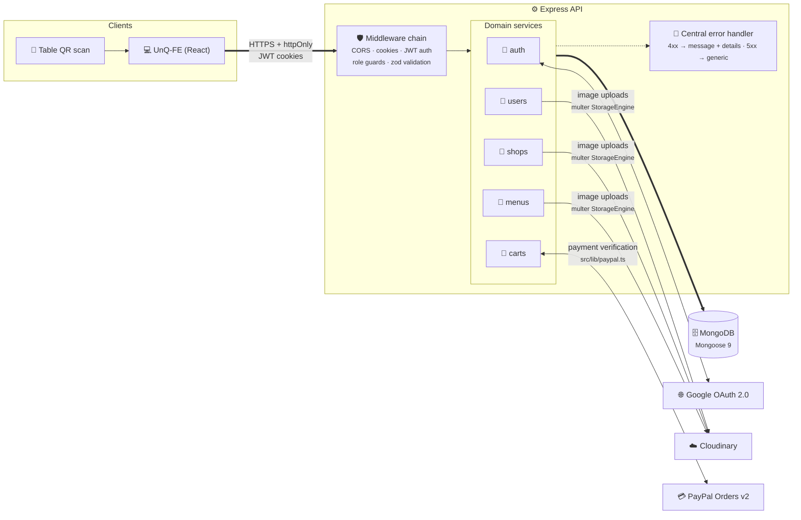

<div id="top"></div>

<!-- PROJECT LOGO -->
<br />
<div align="center">
  <!-- <a href="https://github.com/Nando-C/UnQ-BE">
    
  </a> -->

<h3 align="center">UnQ — Back-End</h3>

  <p align="center">
    QR-code-based table ordering for bars & restaurants — scan, order, split the bill.
    <br />
    <br />
    <a href="https://github.com/Nando-C/UnQ-FE">Front-End Repo</a>
    ·
    <a href="https://github.com/Nando-C/UnQ-FE#try-customer-interface">View Demo</a>
  </p>

  <p align="center">
    =20.19">
    
    
    
    
  </p>
</div>

<!-- TABLE OF CONTENTS -->
<details>
  <summary>Table of Contents</summary>
  <ol>
    <li>
      <a href="#about-the-project">About The Project</a>
      <ul>
        <li><a href="#built-with">Built With</a></li>
      </ul>
    </li>
    <li><a href="#features">Features</a></li>
    <li><a href="#architecture">Architecture</a></li>
    <li><a href="#setup">Setup</a></li>
    <li><a href="#testing">Testing</a></li>
    <li><a href="#models">Models</a>
     <ul>
        <li><a href="#user">User</a></li>
        <li><a href="#shop">Shop</a></li>
        <li><a href="#menu">Menu</a></li>
        <li><a href="#cart">Cart</a></li>
      </ul>
    </li>
    <li><a href="#rest-api">REST API</a>
     <ul>
        <li><a href="#authorization">Authorization</a></li>
        <li><a href="#users">Users</a></li>
        <li><a href="#shops">Shops</a></li>
        <li><a href="#carts">Carts</a></li>
      </ul>
    </li>
    <li><a href="#contact">Contact</a></li>
  </ol>
</details>

<!-- ABOUT THE PROJECT -->

## About The Project

UnQ lets customers scan a QR code on their table, browse a shop's menu, place an order, and split the bill per item with the rest of the table — no app install, no waiting for a waiter to take the order. On the other side, shop managers run their shop's profile, tables, and menu from the same API.

This is the Back-End of my solo capstone project for Strive School's Full-Stack program, built concept-to-deployment in 5 weeks — designing the data model, the REST API, and the authentication/authorization layer, and implementing both the Front-End and Back-End from scratch in that time.

**Recently modernized (2026):** the codebase went through a staged security and quality pass — mass-assignment whitelisting, working refresh-token rotation, short-lived (15m) access tokens, sanitized error responses, `zod` request validation on every mutating endpoint, an integration test suite (Jest + Supertest + an in-memory MongoDB), ESLint, and a dependency refresh that brought `npm audit` to 0 findings.

You can find the Front-End repo of this project in the following link, where more information about the use of this app is shared: [UnQ's Front-End](https://github.com/Nando-C/UnQ-FE)

<p align="right">(<a href="#top">back to top</a>)</p>

### Built With

- [TypeScript](https://typescriptlang.org/)
- [Node.js](https://nodejs.org/)
- [Express.js](https://expressjs.com/)
- [MongoDB](https://www.mongodb.com/) + [Mongoose](https://mongoosejs.com/)
- [Zod](https://zod.dev/)
- [Passport.js](https://www.passportjs.org/) (Google OAuth 2.0)
- [Cloudinary](https://cloudinary.com)
- [Jest](https://jestjs.io/) + [Supertest](https://github.com/ladjs/supertest) + [mongodb-memory-server](https://github.com/typegoose/mongodb-memory-server)

<p align="right">(<a href="#top">back to top</a>)</p>

## Features

- JWT authentication in `httpOnly` cookies, with refresh-token rotation and short-lived (15m) access tokens
- Google OAuth login (Passport), issuing the same cookie pair as email/password login
- Role-based access control (`customer` vs. `shopMg`), enforced per-route
- Shop, table, and menu management for shop managers
- Per-table QR code URLs, generated on table creation
- Shared table carts with per-item bill splitting between multiple customers at the same table
- Cloudinary image uploads for user avatars, shop covers, and menu item photos (images only, up to 5 MB; permissions checked before anything is uploaded, and a replaced image is deleted)
- Request validation (`zod`) on every mutating endpoint, with a consistent `{ message, details }` error shape
- Server-side PayPal checkout: the API creates the order for the exact amount due (database prices, bound to cart + payer via `custom_id`) and captures it only after reserving the units — a conflict discovered before capture costs the buyer nothing, and one discovered in the window after capture is refunded automatically. Order-id replay protection and multi-payer concurrency safety throughout; the API never takes the client's word that a payment happened

<p align="right">(<a href="#top">back to top</a>)</p>

## Architecture



The API is organized service-per-domain: each domain under `src/services/<name>/` owns its `routes.ts`, `model.ts`, `controllers.ts`, and `schemas.ts` (zod). Shared concerns live outside the services:

- `src/services/auth/middlewares.ts` — `JWTAuthMiddleware` (verifies the access-token cookie), `adminOnly` / `isShopManager` (role guards)
- `src/middlewares/validate.ts` — generic `validate(schema)` middleware, runs after auth/role checks and before the controller
- `src/errorMiddlewares.ts` — single error-handling exit point: 4xx errors return `{ message, details? }`, everything else is logged and returns a generic 500
- `src/settings/` — CORS whitelist and a custom Cloudinary multer `StorageEngine`

```
src/
├── index.ts              # env load, mongoose connect, listen
├── server.ts              # express app (exported, not listening — used directly by tests)
├── errorMiddlewares.ts
├── middlewares/
│   └── validate.ts
├── settings/
│   ├── cors.ts
│   └── cloudinary.ts
├── services/
│   ├── auth/               # register, login, refresh, logout, Google OAuth
│   ├── users/               # profile + avatar
│   ├── shops/               # shop CRUD + tables
│   ├── menus/                # menu items
│   └── carts/                # cart, split-bill flows
├── typings/                # shared TS types/interfaces
└── tests/                  # Jest integration suite
```

**Auth flow:** login/register/Google OAuth all issue the same pair of `httpOnly` cookies — a 15-minute access token and a 4-week refresh token. `POST /auth/refreshToken` verifies the refresh token against the one stored on the user document and rotates both cookies; a stale or already-used refresh token is rejected. Google OAuth runs through Passport with `session: false` — no server-side session, just the same JWT cookie pair on redirect.

<p align="right">(<a href="#top">back to top</a>)</p>

## Setup

### Getting Started

1. Copy `.env.example` to `.env` and fill in the required environment variables:
   ```bash
   cp .env.example .env
   ```

2. Install dependencies:
   ```bash
   npm install
   ```

Configuration is centralised in `src/settings/env.ts` — a single zod schema parsed once at import time, exported as a typed frozen object. No other file reads `process.env`.

### Environment Variables

Copy `.env.example` to `.env` and fill it in. Configuration is validated at boot by `src/settings/env.ts`: if anything required is missing or empty, the server prints **every** problem at once (variable names only, never values) and exits non-zero rather than starting in a half-working state.

| Variable | Description |
|---|---|
| `PORT` | Port the server listens on |
| `PUBLIC_API_URL` | Where a **browser** reaches this API — the front-end's proxied prefix (e.g. `https://un-q.vercel.app/api`) when the front-end proxies the API through its own origin, not this server's host. Google's OAuth callback is built from it |
| `FRONTEND_URL` | Front-end URL used for redirects and generated table QR URLs (production) |
| `FRONTEND_DEV_URL` | Front-end URL used as a local-dev fallback when `FRONTEND_URL` isn't set |
| `FRONTEND_PROD_URL` | Front-end production URL, added to the CORS whitelist |
| `MONGO_CONNECTION` | MongoDB connection string |
| `JWT_SECRET` | Signing secret for access tokens |
| `JWT_REFRESH_SECRET` | Signing secret for refresh tokens |
| `GOOGLE_CLIENT_ID` | Google OAuth client ID |
| `GOOGLE_SECRET` | Google OAuth client secret |
| `CLOUDINARY_URL` | Cloudinary account URL (auto-configures the SDK) |
| `PAYPAL_CLIENT_ID` | PayPal client ID (used for server-side order verification) |
| `PAYPAL_CLIENT_SECRET` | PayPal client secret (used for server-side order verification) |
| `PAYPAL_API_BASE` | PayPal API base URL — defaults to the sandbox (`https://api-m.sandbox.paypal.com`) when unset |

### Available Scripts

| Script | Description |
|---|---|
| `npm run dev` | Dev server with hot reload |
| `npm run build` | Compile TypeScript to `./build` |
| `npm start` | Run the compiled build |
| `npm test` | Run the Jest integration suite |
| `npm run lint` | Run ESLint on the `src/` directory |

<p align="right">(<a href="#top">back to top</a>)</p>

## Testing

The API is covered by a Jest + Supertest integration suite running against an in-memory MongoDB (`mongodb-memory-server`) — no external database or network calls required. It covers the full auth flow including refresh-token rotation and role-escalation attempts, authorization boundaries between users/shops/carts (e.g. a customer can't manage a shop, a user can't read another user's cart), the cart and split-bill flows, table QR-code integrity across renames, and mocked upload wiring for the Cloudinary routes. Run it with:

```bash
npm test
```

<p align="right">(<a href="#top">back to top</a>)</p>

<!-- MODELS EXAMPLES -->

## Models

I have used MongoDB with Mongoose to model the data for this application, creating four main models as shown below.

### User

```js
User Model:
    {
        name: string,
        surname: string,
        email: string,
        password: string,
        avatar: string,
        role: {
            type: String,
            enum: ["customer", "shopMg"],
        },
        refreshToken: string,
        googleId: string,
    }
```

<p align="right">(<a href="#top">back to top</a>)</p>

### Shop

```js
Shop Model:
    {
        name: string,
        cover: string,
        bio: string,
        open_times: string,
        phone: number,
        web_URL: string,
        shopMg: {
            type: ObjectId,
            ref: "User",
        },
        tables: [
            {
                name: string,
                Qr_Url: string,
            },
        ],
        menu: [
            {
                type: ObjectId,
                ref: "MenuItem",
            },
        ],
    }
```

<p align="right">(<a href="#top">back to top</a>)</p>

### Menu

```js
MenuItem Model:
    {
        name: string,
        image: string,
        short_description: string,
        description: string,
        price: number,
        available: boolean,
        category: {
            type: String,
            enum: ["food", "drinks"],
        },
    }
```

<p align="right">(<a href="#top">back to top</a>)</p>

### Cart

```js
Cart Model:
    {
        userId: {
            type: ObjectId,
            ref: "User",
        },
        shopId: {
            type: ObjectId,
            ref: "Shop",
        },
        tableId: string,
        status: {
            type: String,
            enum: ["open", "splitted", "closed"],
        },
        items: [
            {
                menuId: {
                    type: ObjectId,
                    ref: "Menu",
                },
                qty: number,
                qtyPayed: number,
            }
        ],
        split: [
            {
                userId: {
                    type: ObjectId,
                    ref: "User",
                },
                menuId: {
                    type: ObjectId,
                    ref: "Menu",
                },
                qty: number,
                splitStatus: {
                    type: String,
                    enum: ["open", "closed"],
                },
                unitPrice: number, // once paid: the price charged per unit
                paidAt: Date,      // once paid
            }
        ],
        // Manager-only: never included in a diner's cart response.
        // Provider-neutral, so other payment providers can record the same way.
        payments: [
            {
                provider: "paypal",
                providerCheckoutId: string, // PayPal: the order id
                providerPaymentId: string,  // PayPal: the capture id (what a refund is made against)
                currency: string,           // "GBP"
                userId: ObjectId,   // the payer
                paidAt: Date,
                amount: number,     // captured, in `currency`
                lines: [
                    { menuId: ObjectId, name: string, qty: number, unitPrice: number, refundedQty: number },
                ],
            }
        ],
    }
```

<p align="right">(<a href="#top">back to top</a>)</p>

## REST API

These are the available endpoints created for this application. Every mutating request is validated (`zod`) and responds `400 { message: "Validation failed", details: [...] }` on bad input.

### Authorization

- [ 'POST' ]

  baseURL-api/auth/refreshToken

- [ 'POST' ]

  baseURL-api/auth/register

- [ 'POST' ]

  baseURL-api/auth/login

- [ 'GET' ]

  baseURL-api/auth/logout

- [ 'GET' ]

  baseURL-api/auth/googleLogin

- [ 'GET' ]

  baseURL-api/auth/googleRedirect

<p align="right">(<a href="#top">back to top</a>)</p>

### Users

- [ 'GET', 'PUT', 'DELETE' ]

  baseURL-api/users/me

- [ 'PUT' ]

  baseURL-api/users/me/avatar

<p align="right">(<a href="#top">back to top</a>)</p>

### Shops

- [ 'POST', 'GET' ]

  baseURL-api/shops

- [ 'GET' ]

  baseURL-api/shops/me

- [ 'GET', 'PUT', 'DELETE' ]

  baseURL-api/shops/:shopId

- [ 'PUT' ]

  baseURL-api/shops/:shopId/cover

- [ 'POST', 'GET' ]

  baseURL-api/shops/:shopId/tables

- [ 'GET', 'PUT', 'DELETE' ]

  baseURL-api/shops/:shopId/tables/:tableId

- [ 'GET' ]

  baseURL-api/shops/:shopId/tables/status

  Shop managers only. One entry per table: `{ tableId, name, state, owed, paid, heldSince?, attention }`. `state` is `free`, `ordering` (items, nothing paid), `waitingToPay` (a diner has items selected) or `partlyPaid`. `attention` flags `soldOut` (unpaid units of an unavailable or deleted item), `staleSelection` (a selection held over 15 minutes) and `duplicateCarts` (more than one open cart). `owed` leaves out sold-out units; `paid` counts units at the price they were paid at.

- [ 'GET' ]

  baseURL-api/shops/:shopId/tables/:tableId/carts

  Shop managers only. `{ open, recentlyClosed }`: the table's open cart(s) and the carts closed in the last 24 hours, newest first, each with its payment records. Diners in selections and payments are shown as `{ _id, name }` (first name only).

- [ 'POST', 'GET' ]

  baseURL-api/shops/:shopId/menu

- [ 'GET', 'PUT', 'DELETE' ]

  baseURL-api/shops/:shopId/menu/:itemId

- [ 'PUT' ]

  baseURL-api/shops/:shopId/menu/:itemId/img

<p align="right">(<a href="#top">back to top</a>)</p>

### Carts

**Sold-out items.** A menu item with `available: false` can't be added to a cart, newly claimed in a split, or paid for (the kitchen only acts on paid orders). Items that sell out while already in a cart stay there — cart responses carry `menuId.available` so the front-end can flag them — until a diner removes them; nothing is removed automatically and paid units are never touched.

- [ 'POST' ]

  baseURL-api/carts/:shopId/tables/:tableId/addItem

  `404` if the item isn't on this shop's menu; `409` (`"This item is sold out"`) if it is unavailable.

- [ 'POST' ]

  baseURL-api/carts/:shopId/tables/:tableId/removeItem

  Rejects with `409` a decrease that would eat into units already paid for or held in an open split.

- [ 'POST' ]

  baseURL-api/carts/:shopId/tables/:tableId/deleteItem

  Removes only the item's **unpaid** units: a partly-paid line is kept with `qty === qtyPayed` as the payment record, and every diner's open split on it is cleared. If nothing unpaid remains, the cart is closed.

- [ 'POST' ]

  baseURL-api/carts/:shopId/tables/:tableId/:cartId/addSplitItem

  Claims units of an item for the caller to pay. Rejects with `409` (`"This item is sold out"`) for an unavailable item, and with `409` (`"Not enough units left to split"`) when the request would push the units claimed by all diners' open splits, plus already-paid units, beyond the item quantity — so two customers can't both hold a split on the same unit.

- [ 'POST' ]

  baseURL-api/carts/:shopId/tables/:tableId/:cartId/decreaseSplitItem

- [ 'POST' ]

  baseURL-api/carts/:shopId/tables/:tableId/:cartId/removeSplitItem

- [ 'POST' ]

  baseURL-api/carts/tables/:tableId/:cartId/createCheckoutOrder

  Server-side checkout, step 1 of 2. No body. Computes the caller's amount due from database prices, checks availability, and creates a PayPal order for that exact amount bound to this cart + payer via `custom_id` (`<cartId>:<userId>`), returning `{ paypalOrderId }` for the buyer to approve in the PayPal popup. Nothing is charged or persisted — a doomed checkout (`409` when the caller's splits would over-settle units another payer holds; `404` when the caller has no open splits) never mints an order. Also `409` (`"Some items you selected are sold out…"`) when any of the caller's selected items is unavailable.

- [ 'POST' ]

  baseURL-api/carts/tables/:tableId/:cartId/captureCheckout

  Server-side checkout, step 2 of 2 — the money-moving endpoint. Body: `{ paypalOrderId }`. Confirms the buyer-approved order was minted for THIS cart + payer (`custom_id` match — `402` otherwise) and still matches the amount due (`409` if the caller changed their selection), re-checks availability (`409`), rejects sold-out items (`409`, same message as `createCheckoutOrder`), and only THEN captures the payment. If a concurrent payer takes the units in the tiny window after capture, the buyer is refunded automatically and the request returns `409` — so a rejection never leaves anyone charged for nothing. Order-id replay is rejected with `402` before any charge. Settlements are recorded per payer in the cart's `paypalOrderIds`, and each one as a provider-neutral payment record (provider, its checkout and payment ids, payer, time, amount and currency, and every line at the price charged; kept out of diner responses). The paid splits carry `unitPrice` and `paidAt`, so what the cart says was paid doesn't change when a menu price is edited later. Together with `createCheckoutOrder` this is **the** checkout flow (charge only after reserving).

- [ 'GET' ]

  baseURL-api/carts/tables/:tableId

- [ 'GET' ]

  baseURL-api/carts

- [ 'GET' ]

  baseURL-api/carts/:cartId

<p align="right">(<a href="#top">back to top</a>)</p>

<!-- CONTACT -->

## Contact

[@Nando](https://hernando-crespo.vercel.app/) - Get in touch and let me know what do you think of this project! 😉

<p align="right">(<a href="#top">back to top</a>)</p>
