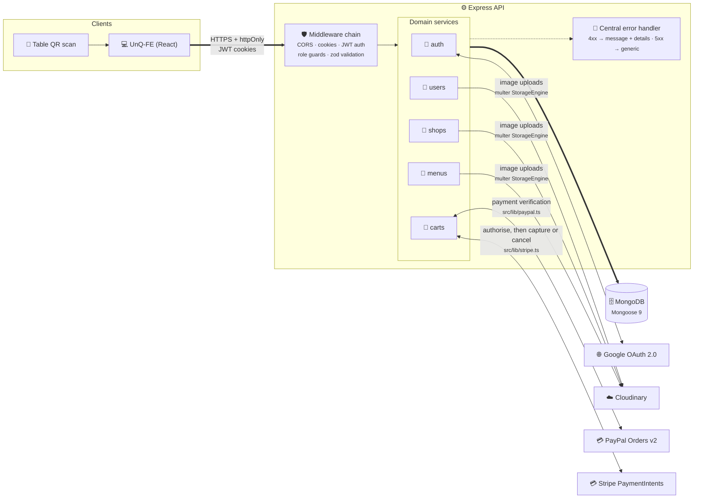
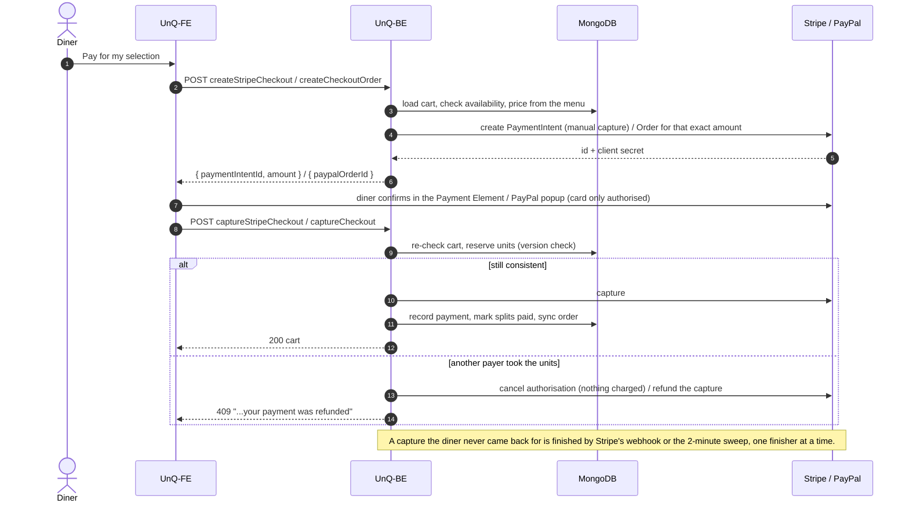

<div id="top"></div>

<!-- PROJECT LOGO -->
<br />
<div align="center">
  <!-- <a href="https://github.com/Nando-C/UnQ-BE">
    
  </a> -->

<h3 align="center">UnQ — Back-End</h3>

  <p align="center">
    The API behind a QR-code table-ordering app: diners scan, order into a shared cart, and each pay for exactly what they picked, by card, Apple Pay, Google Pay or PayPal.
    <br />
    Express 5 · TypeScript 6 · MongoDB · Stripe + PayPal · 501 integration tests
    <br />
    <br />
    <a href="https://github.com/Nando-C/UnQ-FE">Front-End Repo</a>
    ·
    <a href="https://github.com/Nando-C/UnQ-FE#try-customer-interface">View Demo</a>
    ·
    <a href="./CHANGELOG.md">Changelog</a>
    ·
    <a href="https://un-q.vercel.app/api/docs">API docs</a>
  </p>

  <p align="center">
    <a href="https://github.com/Nando-C/UnQ-BE/actions/workflows/ci.yml"></a>
    
    =20.19">
    
    
    
    
  </p>
</div>

<!-- TABLE OF CONTENTS -->
<details>
  <summary>Table of Contents</summary>
  <ol>
    <li>
      <a href="#about-the-project">About The Project</a>
      <ul>
        <li><a href="#built-with">Built With</a></li>
      </ul>
    </li>
    <li><a href="#features">Features</a></li>
    <li><a href="#engineering-decisions">Engineering decisions</a></li>
    <li><a href="#architecture">Architecture</a></li>
    <li><a href="#setup">Setup</a>
      <ul>
        <li><a href="#environment-variables">Environment Variables</a></li>
        <li><a href="#available-scripts">Available Scripts</a></li>
        <li><a href="#versioning-and-releases">Versioning and releases</a></li>
      </ul>
    </li>
    <li><a href="#testing">Testing</a></li>
    <li><a href="#api-reference">API reference</a>
     <ul>
        <li><a href="#checkout-at-a-glance">Checkout at a glance</a></li>
        <li><a href="#data-model">Data model</a></li>
      </ul>
    </li>
    <li><a href="#contact">Contact</a></li>
  </ol>
</details>

<!-- ABOUT THE PROJECT -->

## About The Project

UnQ gives every table in a venue a QR code. Diners scan it, order from the live menu into one shared cart, and split the bill per item, with no app to install and no waiter to wait for. This repository is the API: the data model, authentication, the manager's tools, and the money. The React client lives in [UnQ-FE](https://github.com/Nando-C/UnQ-FE).

The money is the hard part. Several people pay against one cart at the same time, prices change mid-order, items sell out, and a diner can close the tab halfway through a card payment. The API's rule is simple to state and took most of the work to keep: **nothing is charged until the units are reserved, and nobody stays charged for units they didn't get.** Payments are created server-side for a database-priced total, captured only after the cart is re-checked, and refunded automatically if a concurrent payer wins the race after capture. A card payment the diner walks away from is finished by Stripe's webhook or a two-minute sweep, with one finisher at a time, and the diner is told the outcome on their next visit to the table. Money Stripe refuses to return becomes a pay-back the manager has to mark done.

The first version was a five-week solo capstone (2021). The 2026 rebuild brought it to Express 5, TypeScript 6 and Mongoose 9, added zod validation on every write, refresh-token rotation, per-account rate limits, a fail-fast environment schema, and an integration suite of 501 tests against an in-memory MongoDB. `npm audit` reports 0 findings. Every release is listed in the [changelog](./CHANGELOG.md).

<p align="right">(<a href="#top">back to top</a>)</p>

### Built With

- [TypeScript](https://typescriptlang.org/)
- [Node.js](https://nodejs.org/)
- [Express.js](https://expressjs.com/)
- [MongoDB](https://www.mongodb.com/) + [Mongoose](https://mongoosejs.com/)
- [Zod](https://zod.dev/)
- [express-rate-limit](https://express-rate-limit.mintlify.app/)
- [Passport.js](https://www.passportjs.org/) (Google OAuth 2.0)
- [Cloudinary](https://cloudinary.com)
- [Stripe](https://stripe.com) (the official `stripe` client)
- [Jest](https://jestjs.io/) + [Supertest](https://github.com/ladjs/supertest) + [mongodb-memory-server](https://github.com/typegoose/mongodb-memory-server)

<p align="right">(<a href="#top">back to top</a>)</p>

## Features

- JWT authentication in `httpOnly` cookies, with refresh-token rotation and short-lived (15m) access tokens
- Google OAuth login (Passport), issuing the same cookie pair as email/password login
- Role-based access control (`customer` vs. `shopMg`), enforced per-route
- Shop, table, and menu management for shop managers
- Per-table QR code URLs, generated on table creation
- Shared table carts with per-item bill splitting between multiple customers at the same table
- Cloudinary image uploads for user avatars, shop covers, and menu item photos (images only, up to 5 MB; permissions checked before anything is uploaded, and a replaced image is deleted)
- Request validation (`zod`) on every mutating endpoint, with a consistent `{ message, details }` error shape
- Server-side PayPal checkout: the API creates the order for the exact amount due (database prices, bound to cart + payer via `custom_id`) and captures it only after reserving the units — a conflict discovered before capture costs the buyer nothing, and one discovered in the window after capture is refunded automatically. Order-id replay protection and multi-payer concurrency safety throughout; the API never takes the client's word that a payment happened
- Card payments (Apple Pay and Google Pay included) through Stripe, beside PayPal, with the same guarantee: the diner's card is only authorised, the API re-checks the cart and then captures, or cancels the authorisation so nothing is charged. One finisher at a time per payment (the diner's request, Stripe's webhook, or a sweep every 2 minutes), so an authorised payment the diner walked away from is still finished, and they're told the outcome on their next visit to the table. Money Stripe won't give back (a refund that failed for good) becomes a pay-back on the table, flagged to the shop's managers until one marks it done
- Manager tools for the live floor: each table's status and attention flags, its carts with payments and a log of what managers and the server did, releasing selections, closing and merging carts, refunds with a reason, retries of unclear refunds, and checks of payments a provider holds as pending
- An order per payment as the sales record, rebuilt from the cart and kept when the cart, table or shop is deleted; a paged, server-searched shop list; per-account rate limits on wrong passwords and cart edits

<p align="right">(<a href="#top">back to top</a>)</p>

## Engineering decisions

- **The client never names an amount.** Both PayPal orders and Stripe PaymentIntents are created by the API from database prices and bound to the cart and payer (PayPal's `custom_id`, Stripe's own `StripeCheckout` record). The front end only relays the buyer's approval. A tampered total, a replayed order id, or an order minted for another cart is refused before any money moves.
- **Reserve, then charge, with optimistic concurrency instead of locks.** Every cart write checks the document's version (`__v`). Two diners claiming the last unit of an item resolve at the database, not in application memory, so no request depends on which process served the one before it (the in-memory rate counters are the one exception, noted under [rate limits](./docs/api.md#rate-limits)).
- **One finisher per card payment.** The diner's request, Stripe's webhook and a two-minute sweep can all try to finish the same payment. Each claims its record with a token and a short lease, so a capture happens exactly once, and a payment the diner abandoned is still settled.
- **Orders are a separate collection, rebuilt from the cart.** The cart stays the source of truth for the live table. The order is the sales record, so it outlives the cart, the table, the menu item and the shop. A sync that fails after the money moved is logged and repaired by a script, never surfaced to the diner as a failed payment.
- **Pay-backs are their own collection.** A refund can fail days after the cart was closed and deleted. Keeping the debt on the cart would lose it with the cart.
- **Configuration fails at boot, not at first use.** One zod schema parses the environment once. A missing variable prints every problem by name and exits, rather than turning into the string `undefined` inside Google's callback URL.
- **Rate limits count per account, not per IP.** Behind the front end's proxy, client addresses aren't reliable. Wrong passwords and cart edits are limited per user; starting a card payment counts as an edit (each call makes a Stripe intent), and capturing a payment is never limited: a refused capture would leave an authorised payment unfinished.
- **Deletions are soft where money can still move.** A deleted table stays under its shop's `deletedTables` so its carts can be refunded; a deleted menu item stays, unavailable, so carts holding it still show its name; a shop can't be deleted while a payment, refund or pay-back is still in flight.
- **Tests run the real stack.** The suite drives the Express app through Supertest against an in-memory MongoDB, with a fake Stripe that changes payments the way Stripe does, so the races between the diner's request, the webhook and the sweep are replayed on every run. An index test fails if any route scans a collection.

<p align="right">(<a href="#top">back to top</a>)</p>

## Architecture



The API is organized service-per-domain: each domain under `src/services/<name>/` owns its `routes.ts`, `model.ts`, `controllers.ts`, and `schemas.ts` (zod). Shared concerns live outside the services:

- `src/services/auth/middlewares.ts` — `JWTAuthMiddleware` (verifies the access-token cookie), `adminOnly` / `isShopManager` (role guards)
- `src/middlewares/validate.ts` — generic `validate(schema)` middleware, runs after auth/role checks and before the controller
- `src/lib/passwordLimit.ts` and `src/middlewares/rateLimits.ts` — the wrong-password and cart-change rate limits (see [rate limits](./docs/api.md#rate-limits))
- `src/openapi/` — the API's OpenAPI document, built from the zod schemas and the controllers' answers, and the routes that serve it (`/docs`, `/openapi.json`) and `/health`
- `src/errorMiddlewares.ts` — single error-handling exit point: 4xx errors return `{ message, details? }`, everything else is logged and returns a generic 500
- `src/settings/` — CORS whitelist and a custom Cloudinary multer `StorageEngine`
- `src/lib/payments.ts` — refunds and payment checks for either provider; `src/lib/paypal.ts` and `src/lib/stripe.ts` are the providers' clients

```
src/
├── index.ts              # env load, mongoose connect, listen
├── server.ts              # express app (exported, not listening — used directly by tests)
├── errorMiddlewares.ts
├── openapi/               # the OpenAPI document (paths/ per service, components.ts) and /docs, /openapi.json, /health
├── middlewares/
│   ├── rateLimits.ts
│   └── validate.ts
├── settings/
│   ├── cors.ts
│   └── cloudinary.ts
├── services/
│   ├── auth/               # register, login, refresh, logout, Google OAuth
│   ├── users/               # profile + avatar
│   ├── shops/               # shop CRUD + tables
│   ├── menus/                # menu items
│   ├── carts/                # cart, split-bill flows, checkout (stripeFinish.ts: finishing card payments)
│   └── payments/             # Stripe's webhook; pay-backs (money staff give a diner back by hand)
├── scripts/                # repair scripts (tsx) and validateOpenApi.mjs
├── typings/                # shared TS types/interfaces
└── tests/                  # Jest integration suite
```

**Auth flow:** login/register/Google OAuth all issue the same pair of `httpOnly` cookies — a 15-minute access token and a 4-week refresh token. `POST /auth/refreshToken` verifies the refresh token against the one stored on the user document and rotates both cookies; a refresh token that's expired, invalid, or was replaced a while ago (a sign-in on another device, a logout, a password change) is rejected with a `401` and both cookies are cleared, so that device carries on as a guest. One replaced within the last minute gets a `401` with the cookies left alone and `reason: "superseded"` in the body: another tab in the same browser has just refreshed, and they're its new ones, so the request that needed the refresh can be sent again. Each account holds one refresh token, so signing in on one device ends the session on the others. Google OAuth runs through Passport with `session: false` — no server-side session, just the same JWT cookie pair on redirect. A Google sign-in whose verified email matches an existing account links to it and removes that account's password (nothing proved whoever set it owned the address), so from then on it signs in with Google. A new Google account takes its name from Google and has no surname when Google gives no family name. Emails are stored trimmed and lowercase, and match however they're capitalised.

<p align="right">(<a href="#top">back to top</a>)</p>

## Setup

### Getting Started

1. Copy `.env.example` to `.env` and fill in the required environment variables:
   ```bash
   cp .env.example .env
   ```

2. Install dependencies:
   ```bash
   npm install
   ```

3. To receive Stripe's webhook events locally, forward them to the dev server with the [Stripe CLI](https://docs.stripe.com/stripe-cli) (its signing secret, from `stripe listen --print-secret`, is `STRIPE_WEBHOOK_SECRET`; it stays the same for this machine and account):
   ```bash
   stripe listen \
     --events payment_intent.amount_capturable_updated,payment_intent.succeeded,payment_intent.payment_failed,payment_intent.canceled,refund.failed \
     --forward-to localhost:3001/payments/stripe/webhook
   ```
   Recent Stripe CLI versions require `--events`; these are the five the API acts on.
   Deployed, the endpoint is added in Stripe's dashboard (Developers → Webhooks) with the events `payment_intent.amount_capturable_updated`, `payment_intent.succeeded`, `payment_intent.payment_failed`, `payment_intent.canceled` and `refund.failed`, and its signing secret set on the host before the API deploys (the API won't start without it).

4. For something to look at, write the demo data (three shops, 90 days of payments; see [docs/operations.md](./docs/operations.md#the-demo-data)) with the two sign-ins' passwords set in `.env`:
   ```bash
   npm run seed:demo
   ```
   Sign in as `manager@mail.com` for the manager's pages, or scan the demo shop's QR table.

Configuration is centralised in `src/settings/env.ts` — a single zod schema parsed once at import time, exported as a typed frozen object. No other file reads `process.env`.

### Environment Variables

Copy `.env.example` to `.env` and fill it in. Configuration is validated at boot by `src/settings/env.ts`: if anything required is missing or empty, the server prints **every** problem at once (variable names only, never values) and exits non-zero rather than starting in a half-working state.

| Variable | Description |
|---|---|
| `PORT` | Port the server listens on |
| `PUBLIC_API_URL` | Where a **browser** reaches this API — the front-end's proxied prefix (e.g. `https://un-q.vercel.app/api`) when the front-end proxies the API through its own origin, not this server's host. Google's OAuth callback is built from it |
| `FRONTEND_URL` | Front-end URL used for redirects and generated table QR URLs (production) |
| `FRONTEND_DEV_URL` | Front-end URL used as a local-dev fallback when `FRONTEND_URL` isn't set |
| `FRONTEND_PROD_URL` | Front-end production URL, added to the CORS whitelist |
| `MONGO_CONNECTION` | MongoDB connection string |
| `JWT_SECRET` | Signing secret for access tokens |
| `JWT_REFRESH_SECRET` | Signing secret for refresh tokens |
| `GOOGLE_CLIENT_ID` | Google OAuth client ID |
| `GOOGLE_SECRET` | Google OAuth client secret |
| `CLOUDINARY_URL` | Cloudinary account URL (auto-configures the SDK) |
| `PAYPAL_CLIENT_ID` | PayPal client ID (used for server-side order verification) |
| `PAYPAL_CLIENT_SECRET` | PayPal client secret (used for server-side order verification) |
| `PAYPAL_API_BASE` | PayPal API base URL — defaults to the sandbox (`https://api-m.sandbox.paypal.com`) when unset |
| `STRIPE_SECRET_KEY` | Stripe secret key: `sk_test_…` for test mode, `sk_live_…` for live (the server logs which at boot) |
| `STRIPE_WEBHOOK_SECRET` | Signing secret (`whsec_…`) of the Stripe webhook endpoint; locally, `stripe listen --print-secret` |
| `PASSWORD_FAILS_PER_ACCOUNT` | Wrong passwords allowed per account in 15 minutes (default 10) |
| `CART_EDITS_PER_MINUTE` | Cart changes allowed per diner a minute (default 120) |
| `BCRYPT_ROUNDS` | bcrypt cost for stored passwords, 10–13 (default 10; lower refused except inside the test suite, which uses 4) |
| `DEMO_MANAGER_PASSWORD` | The demo manager's password, set by `npm run seed:demo` (the seed refuses to run without it) |
| `DEMO_DINER_PASSWORD` | The demo diner's password, set by the same seed |

### Dependency override

`package.json`'s `overrides` gives `@istanbuljs/load-nyc-config` (pulled in by Jest's coverage tooling) `js-yaml` 4 instead of 3. js-yaml 3 depends on `argparse@1` → `sprintf-js`, which has an open advisory (GHSA-hp3w-g68c-fv3c) with no fixed version. That module only calls `js-yaml`'s `load()`, which works the same in 4. Remove the override once `@istanbuljs/load-nyc-config` itself depends on js-yaml 4 (check with `npm ls js-yaml`).

### Available Scripts

| Script | Description |
|---|---|
| `npm run dev` | Dev server with hot reload |
| `npm run build` | Compile TypeScript to `./build` |
| `npm start` | Run the compiled build |
| `npm test` | Run the Jest integration suite |
| `npm run lint` | Run ESLint on the `src/` directory |
| `npm run seed:demo` | Write the demo data: three shops with menus and tables, 90 days of payments, refunds and pay-backs, and two sign-ins whose passwords come from `.env`. Reruns rewrite only what it owns |
| `npx tsx src/scripts/syncOrders.ts` | Write or bring up to date every payment's order (backfill, and repair after "Order not written"); safe to rerun |
| `npx tsx src/scripts/finishStripeCheckouts.ts` | Finish the card payments left unfinished, as the server does every 2 minutes; safe to run beside it |
| `npx tsx src/scripts/findDuplicateOpenCarts.ts` | List the tables with more than one open cart, when the startup index build reports duplicates |
| `node src/scripts/validateOpenApi.mjs [url \| file]` | Validate an OpenAPI document against the OpenAPI 3.1 schema (default: the dev server's `/openapi.json`) |

### Versioning and releases

UnQ ships as two repositories that release together, each with its own [Semantic Versioning](https://semver.org/) number and a [changelog](./CHANGELOG.md).

- A front-end release `x.y.*` needs this API at `x.y.0` or later. The shared MINOR says which pair belong together; patches are independent.
- The MAJOR changes only when a release needs a change on the deployment host (new variables, a new webhook, a deploy order) or breaks a route the front end uses. 2.0.0 is one: see the changelog's deploy notes.
- Within a pair, the API deploys first.

```bash
npm version minor --no-git-tag-version   # or patch / major; then write the CHANGELOG entry
git tag -a v2.1.0 -m "UnQ API 2.1.0"
git push --follow-tags
```

<p align="right">(<a href="#top">back to top</a>)</p>

## Testing

The API is covered by a Jest + Supertest integration suite running against an in-memory MongoDB (`mongodb-memory-server`) — no external database or network calls required. It covers the full auth flow including refresh-token rotation and role-escalation attempts, authorization boundaries between users/shops/carts (e.g. a customer can't manage a shop, a user can't read another user's cart), the cart and split-bill flows, table QR-code integrity across renames, and mocked upload wiring for the Cloudinary routes. PayPal is mocked at its client, and Stripe by an in-memory fake (`src/tests/fakeStripe.ts`) that changes payments the way Stripe does, so the card checkout's races (the diner's request against the webhook and the sweep, captures whose outcome is unknown, refunds after a lost race) are played out without the network. Two suites guard the docs: the OpenAPI document must list exactly the routes the server serves and validate against the OpenAPI schema, and the README's variable table, `.env.example` and every relative link in the Markdown must match the code and the files. Run it with:

```bash
npm test
```

To try card payments by hand, use a Stripe test key (`sk_test_…`) and Stripe's test cards, with any future expiry date and any CVC: `4242 4242 4242 4242` pays, `4000 0025 0000 3155` asks for the bank's check first, and `4000 0000 0000 0002` is declined.

<p align="right">(<a href="#top">back to top</a>)</p>

<!-- API -->

## API reference

The contract is an OpenAPI 3.1 document the server builds from its own code: request bodies from the zod schemas each route validates with, responses and messages written from the controllers. Browse it with Swagger UI at [`/docs`](https://un-q.vercel.app/api/docs) (live) or on a dev server at `http://localhost:3001/docs`; the raw document is `/openapi.json`. A test keeps it complete: every route the server serves is in it and nothing else, and it validates against the OpenAPI schema. Route paths and shapes are frozen for the front end; changes are additive.

- [docs/api.md](./docs/api.md): the conventions (cookies, roles, ids, money, errors), the rate limits, what each checkout step guards, and Stripe's webhook.
- [docs/data-model.md](./docs/data-model.md): the seven collections field by field, and the rules and indexes the code keeps.
- [docs/payments.md](./docs/payments.md): how money moves: reserve then charge, the rules that hold everywhere, one finisher per card payment, pending payments, refunds and pay-backs, the accepted residual risks.
- [docs/auth.md](./docs/auth.md): the two cookies, refresh rotation, passwords and their limit, Google sign-in and account linking, roles and the three guards, CORS.
- [docs/operations.md](./docs/operations.md): how the server starts, the configuration that catches people out, where it runs, the deploy order, gates and CI, the repair scripts, what to look at when something is wrong.
- [docs/decisions.md](./docs/decisions.md): the choices that shape the API, each with its context and consequences.
- [docs/known-gaps.md](./docs/known-gaps.md): accepted residuals, open bugs, deferred work and the roadmap.

### Checkout at a glance



### Data model

MongoDB through Mongoose, in seven collections: `users`, `shops` (tables inside), `menus`, `carts`, `orders`, `stripecheckouts` and `paybacks`. The cart is the live record of a table; the payment records on it, the card payment records, the orders and the pay-backs are the money's records, kept where deleting a cart, a table or a shop can't reach them. Field by field in [docs/data-model.md](./docs/data-model.md); as the API answers them, under Schemas in [`/docs`](https://un-q.vercel.app/api/docs).

<p align="right">(<a href="#top">back to top</a>)</p>

<!-- CONTACT -->

## Contact

[@Nando](https://hernando-crespo.vercel.app/) - Get in touch and let me know what do you think of this project! 😉

<p align="right">(<a href="#top">back to top</a>)</p>
