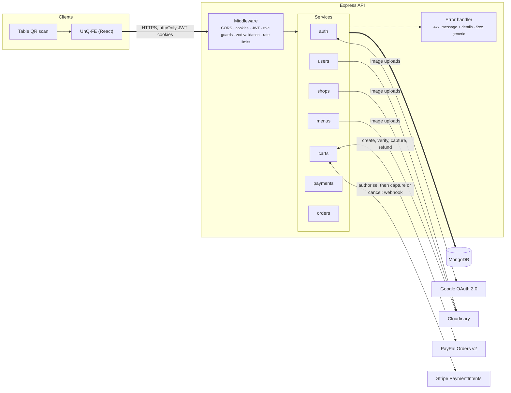

# UnQ API

The API behind UnQ, a QR-code ordering app for venues. Diners scan the code on their table, order into one shared cart, and each pay for exactly what they picked, by card, Apple Pay, Google Pay or PayPal. This repository holds the data model, authentication, the manager's tools and the money. The React client is [UnQ-FE](https://github.com/Nando-C/UnQ-FE).

Express 5 · TypeScript 6 · MongoDB with Mongoose 9 · Stripe and PayPal · Jest integration suite

[](https://github.com/Nando-C/UnQ-BE/actions/workflows/ci.yml)
[](./LICENSE)
[](./CHANGELOG.md)

<a href="https://un-q.vercel.app/api/docs"></a>

## What it does

- **Live**: the API runs at `https://unq-be.onrender.com` and answers the client at [un-q.vercel.app](https://un-q.vercel.app), which proxies `/api` to it. Its reference is at [un-q.vercel.app/api/docs](https://un-q.vercel.app/api/docs). It sleeps on Render's free tier, so the first request after a quiet spell takes up to a minute.
- **Diners** sign in, order into a table's shared cart, select the units they will pay for, and pay. The API creates each payment from database prices and captures it only after re-checking the cart.
- **Managers** run their shops, menus and tables; see each table's state and what needs a look; release selections, remove items, close and merge carts; refund lines of a payment with a reason; check payments a provider holds; and settle what a provider won't return.
- **Money keeps records**: an order per payment for the sales reports, a record per card payment for the audit trail, and a pay-back per sum staff must return by hand. Each outlives the cart, table and shop it came from.

## What it has to get right

**Nothing is charged until the units are reserved, and nobody stays charged for units they didn't get.** The rule is simple to state and took most of the work to keep. Several people pay against one cart at the same time, prices change mid-order, items sell out, and a diner can close the tab halfway through a card payment. Payments are created server-side for a database-priced total, captured only after the cart is re-checked under optimistic concurrency, and refunded automatically if a concurrent payer wins the race after capture. A card payment the diner walks away from is finished by Stripe's webhook or a two-minute sweep, one finisher at a time by claim and lease, and the diner is told the outcome on their next visit. Money Stripe refuses to return becomes a pay-back the manager has to mark done. The reasoning, step by step, is in [docs/payments.md](./docs/payments.md).

## Engineering decisions

Each with its reason and what it costs; the full log is [docs/decisions.md](./docs/decisions.md).

- **The client never names an amount.** PayPal orders and Stripe PaymentIntents are created by the API from database prices and bound to the cart and payer. A tampered total, a replayed order id or an order minted for another cart is refused before any money moves. Cost: two server calls per payment and a verification of the provider's answer.
- **Reserve, then charge, with optimistic concurrency instead of locks.** Every cart write checks the document's version. Two diners claiming the last unit resolve at the database, not in application memory, so no request depends on which process served the one before. Cost: a retry loop at each writer and a few spurious 409s at a busy table. [payments.md](./docs/payments.md#rules-that-hold-everywhere)
- **One finisher per card payment, by claim and lease.** The diner's request, Stripe's webhook and the sweep can all try to finish the same payment. Each claims its record with a token and a two-minute lease, so a capture happens once and an abandoned payment is still settled. Stripe's idempotency keys couldn't do it: a second request while the first runs gets a 409, and a cached error replays for a day. [payments.md](./docs/payments.md#card-payments-one-finisher)
- **Orders are a separate collection, rebuilt from the cart.** The cart stays the truth for the live table; the order is the sales record and outlives the cart, the table, the menu item and the shop. A sync that fails after the money moved is logged and repaired by a script, never surfaced to the diner as a failed payment. [data-model.md](./docs/data-model.md#order)
- **Pay-backs are their own collection.** A refund can fail days after the cart was closed and deleted; keeping the debt on the cart would lose it with the cart. [payments.md](./docs/payments.md#pay-backs)
- **Configuration fails at boot.** One zod schema parses the environment once and prints every missing name at once, rather than turning into the string `undefined` inside Google's callback URL. [operations.md](./docs/operations.md#how-the-server-starts)
- **Rate limits count per account, not per address.** Behind the client's proxy and the host's, addresses aren't reliable, and a venue's diners share one. Wrong passwords and cart edits are limited per user; capturing a payment never is, since a refused capture would leave an authorised payment unfinished. Cost: a stranger who knows an email can lock that account's password sign-in for fifteen minutes (Google sign-in still works). [api.md](./docs/api.md#rate-limits)
- **Deletions are soft where money can still move.** A deleted table stays under its shop so its carts can be refunded; a deleted menu item stays, unavailable, so carts holding it keep its name; a shop isn't deleted while a payment, refund or pay-back is in flight. [data-model.md](./docs/data-model.md#conventions)
- **Tests drive the real app against a real database.** The suite drives the Express app through Supertest against an in-memory MongoDB, with a fake Stripe that changes payments the way Stripe does, so the races between the diner's request, the webhook and the sweep are replayed on every run. An index test fails if a main route scans a collection. [Testing](#testing-and-ci)

## Architecture



Each domain under `src/services/<name>/` owns its routes, model, controllers and zod schemas. What they share lives outside them:

```
src/
├── index.ts               boot: validate the environment, connect, build indexes, listen, start the sweep
├── server.ts              the Express app, exported without listening (the tests drive it directly)
├── errorMiddlewares.ts    the one error exit: 4xx with message and details, 5xx generic
├── openapi/               the OpenAPI document built from the code; /docs, /openapi.json, /health
├── middlewares/           validate(schema), the rate limits
├── settings/              env.ts (the schema), cors.ts, cloudinary.ts
├── lib/                   money, payments (both providers), paypal, stripe, the password limit
├── services/
│   ├── auth/              register, login, refresh, logout, Google OAuth, the guards
│   ├── users/             profile and avatar
│   ├── shops/             shops and their tables
│   ├── menus/             menu items
│   ├── carts/             the cart, split bills, checkout, the card payment finisher, manager actions
│   ├── payments/          Stripe's webhook, pay-backs
│   └── orders/            the sales record and its sync
├── scripts/               the demo seed, repair scripts, the OpenAPI validator
├── typings/               shared types
└── tests/                 the Jest suite, its in-memory database and the fake Stripe
```

**How the two apps talk.** The client calls the API on its own origin; Vercel rewrites `/api/*` to this host, so the session cookies are first-party and Safari keeps them. Sign-in is two httpOnly cookies, a fifteen-minute access token and a four-week refresh token, rotated on refresh, one session per device. The client refreshes on a 401 and retries. At checkout the client asks the API to create the payment, hands the provider's secret or order id to Stripe's form or PayPal's popup, and after the diner confirms asks the API to capture; the API re-checks the cart and only then takes the money. The sequence is drawn in [docs/api.md](./docs/api.md#checkout-at-a-glance).

## Quick start

Node 20.19 or later. The test suite needs nothing else: it starts its own in-memory MongoDB and mocks every provider.

```bash
git clone https://github.com/Nando-C/UnQ-BE.git && cd UnQ-BE
npm install
cp .env.example .env     # then fill it in, below
npm run dev              # http://localhost:3001, Swagger UI at /docs
```

To run the API for real you need a MongoDB (a local `mongod`, or [Atlas](https://www.mongodb.com/atlas)), and test-mode credentials from each provider: a [Stripe test secret key](https://dashboard.stripe.com/test/apikeys) and a webhook signing secret (locally, from the [Stripe CLI](https://docs.stripe.com/stripe-cli)), a [PayPal sandbox app](https://developer.paypal.com/dashboard/applications/sandbox), a [Google OAuth client](https://console.cloud.google.com/apis/credentials) with `PUBLIC_API_URL/auth/googleRedirect` as an authorised redirect URI, and a [Cloudinary](https://console.cloudinary.com/) account for the images. The server validates the whole file at boot and lists every missing name.

To see card payments finish on their own, forward Stripe's events to the dev server:

```bash
stripe listen --events payment_intent.amount_capturable_updated,payment_intent.succeeded,payment_intent.payment_failed,payment_intent.canceled,refund.failed --forward-to localhost:3001/payments/stripe/webhook
```

For something to look at, and a manager to sign in as, write the demo data: three venues with menus and tables, forty diners, ninety days of payments and refunds shaped the way a real history is (busy hours, regulars, a new dish, a bad week), and the live table states. Set `DEMO_MANAGER_PASSWORD` and `DEMO_DINER_PASSWORD` in `.env` first; the manager is `manager@mail.com`. The tables' QR codes point at `FRONTEND_URL`, so a deployed database is seeded with it set to the live client. The live demo is reseeded every night by a workflow, from repository secrets ([operations](./docs/operations.md#the-demo-data)).

```bash
npm run seed:demo
```

A manager is an account with the `shopMg` role, which only the database sets (the sign-up form can't). To promote an account of your own:

```js
db.users.updateOne({ email: "you@example.com" }, { $set: { role: "shopMg" } })
```

### Environment variables

| Variable | Description |
|---|---|
| `PORT` | Port the server listens on (default 3001) |
| `PUBLIC_API_URL` | Where a **browser** reaches this API: the client's proxied prefix (`https://un-q.vercel.app/api`), not this server's host. Google's OAuth callback is built from it |
| `FRONTEND_URL` | The client's URL, for OAuth redirects and the tables' QR URLs (production) |
| `FRONTEND_DEV_URL` | The client's URL in development; the fallback when `FRONTEND_URL` isn't set |
| `FRONTEND_PROD_URL` | The client's production origin, for the CORS whitelist |
| `MONGO_CONNECTION` | MongoDB connection string |
| `JWT_SECRET` | Signing secret for access tokens |
| `JWT_REFRESH_SECRET` | Signing secret for refresh tokens |
| `GOOGLE_CLIENT_ID` | Google OAuth client id |
| `GOOGLE_SECRET` | Google OAuth client secret |
| `CLOUDINARY_URL` | Cloudinary account URL; the SDK reads it itself |
| `PAYPAL_CLIENT_ID` | PayPal app client id |
| `PAYPAL_CLIENT_SECRET` | PayPal app client secret |
| `PAYPAL_API_BASE` | PayPal API base URL; the sandbox when unset |
| `STRIPE_SECRET_KEY` | Stripe secret key: `sk_test_…` for test mode, `sk_live_…` for live; the server logs which at boot |
| `STRIPE_WEBHOOK_SECRET` | Signing secret (`whsec_…`) of the Stripe webhook endpoint |
| `PASSWORD_FAILS_PER_ACCOUNT` | Wrong passwords allowed per account in fifteen minutes (default 10) |
| `CART_EDITS_PER_MINUTE` | Cart changes allowed per diner a minute (default 120) |
| `BCRYPT_ROUNDS` | bcrypt cost for stored passwords, 10 to 13 (default 10) |
| `DEMO_MANAGER_PASSWORD` | The demo manager's password, set by `npm run seed:demo` |
| `DEMO_DINER_PASSWORD` | The demo diner's password, set by the same seed |

### Scripts

| Script | What it does |
|---|---|
| `npm run dev` | Dev server with reload |
| `npm run build` / `npm start` | Compile to `build/`, run the compiled build |
| `npm test` | The Jest integration suite |
| `npm run lint` | ESLint over `src/` |
| `npm run seed:demo` | Write the demo data; reruns rewrite only what it owns |
| `npx tsx src/scripts/syncOrders.ts` | Write or repair every payment's order |
| `npx tsx src/scripts/finishStripeCheckouts.ts` | Finish the card payments left unfinished, as the sweep does |
| `npx tsx src/scripts/findDuplicateOpenCarts.ts` | List tables with more than one open cart |
| `node src/scripts/validateOpenApi.mjs [url \| file]` | Validate an OpenAPI document against the OpenAPI schema (default: the dev server's) |

## Testing and CI

The suite drives the Express app through Supertest against an in-memory MongoDB, with PayPal mocked at its client and Stripe replaced by an in-memory fake that changes payments the way Stripe does. It covers the auth flow with refresh rotation and role escalation attempts, the authorisation boundaries between users, shops and carts, the cart and split-bill flows, both checkouts with their races (the diner's request against the webhook and the sweep, captures with an unknown outcome, refunds after a lost race), the manager's actions, refunds and pay-backs, the demo seed run twice over, and the repository itself: the OpenAPI document must list exactly the served routes and validate, and the README's variable table, `.env.example` and every Markdown link must match the code and the files.

```bash
npm test
```

CI runs the type check, the lint, the suite and the build on Node 24 for every push to `main` and every pull request. No secrets: the suite fills the required variables itself. The gates and the deploy order are in [docs/operations.md](./docs/operations.md#gates-and-ci).

To try card payments by hand, use a test key and Stripe's test cards with any future expiry and any CVC: `4242 4242 4242 4242` pays, `4000 0025 0000 3155` asks for the bank's check first, `4000 0000 0000 0002` is declined.

## Documentation

The contract is an OpenAPI 3.1 document the server builds from its own code, browsable at [`/docs`](https://un-q.vercel.app/api/docs) and served raw at `/openapi.json`; a test keeps it complete. Route paths and shapes are frozen for the client; changes are additive.

- [docs/api.md](./docs/api.md): the conventions (cookies, roles, ids, money, errors), the rate limits, what each checkout step guards, Stripe's webhook, how the sales report counts.
- [docs/data-model.md](./docs/data-model.md): the seven collections field by field, and the rules and indexes the code keeps.
- [docs/payments.md](./docs/payments.md): how money moves: reserve then charge, one finisher per card payment, pending payments, refunds and pay-backs, the accepted residual risks.
- [docs/auth.md](./docs/auth.md): the two cookies, refresh rotation, passwords and their limit, Google sign-in, roles and guards, CORS.
- [docs/operations.md](./docs/operations.md): how the server starts, the configuration that catches people out, where it runs, the deploy order, the demo data, the repair scripts.
- [docs/decisions.md](./docs/decisions.md): the choices that shape the API, each with its context and consequences.
- [docs/known-gaps.md](./docs/known-gaps.md): accepted residuals, open bugs, deferred work and the roadmap.
- [CHANGELOG.md](./CHANGELOG.md): every release, with its deploy notes.
- [SECURITY.md](./SECURITY.md): how to report a vulnerability, and what the demo is for.

## Roadmap

Next is a sales dashboard over the report route, then staff on a shop and staff roles, and kitchen screens with live updates. The list and its order are in [known-gaps.md](./docs/known-gaps.md#roadmap).

## About

UnQ began as a five-week solo capstone in 2021 and was rebuilt in 2026: Express 5, TypeScript 6 and Mongoose 9, validation on every write, refresh-token rotation, card payments beside PayPal, the manager's tools, the integration suite, the OpenAPI contract. Released under the [MIT licence](./LICENSE).

[Hernando Crespo](https://hernando-crespo.vercel.app/) · [the client](https://github.com/Nando-C/UnQ-FE) · [the live demo](https://un-q.vercel.app)
