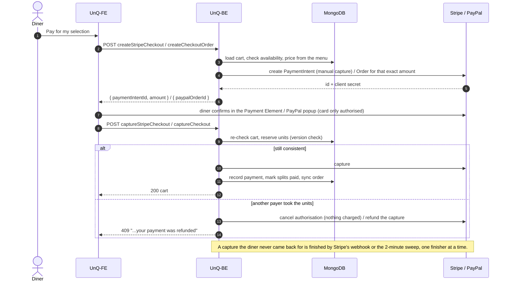

# API

The contract is the OpenAPI 3.1 document the server builds from its own code and serves at **`GET /openapi.json`**, browsable with Swagger UI at **`GET /docs`** (live: [un-q.vercel.app/api/docs](https://un-q.vercel.app/api/docs)). Request bodies there come straight from the zod schemas each route validates with; responses, statuses and messages were written from the controllers (`src/openapi/`, one file per service). A test keeps it honest: it lists exactly the routes the server serves, every path parameter is declared, and the document validates against the OpenAPI schema (`src/tests/openapi.test.ts`). The front end is built against it: route paths and shapes are frozen; changes are additive.

This page holds what a reference can't: the conventions, the limits, and how checkout fits together.

## Conventions

- **Base URL.** In production the front end proxies the API under its own origin (`https://un-q.vercel.app/api`), so the auth cookies are first-party. `PUBLIC_API_URL` is that address, and the first `servers` entry of the document.
- **Sign-in** is two `HttpOnly; Secure; SameSite=None` cookies: `accessToken` (15 minutes) and `refreshToken` (4 weeks), set by register, login and Google's callback. A `401` means refresh (`POST /auth/refreshToken`) and retry; a refresh that fails clears both cookies and ends the session. Each sign-in is a session of its own, so an account can be signed in on up to ten devices; a logout ends only that device's, a password change ends all the others, and `GET /auth/sessions` and `DELETE /auth/sessions/:sessionId` list and sign out devices.
- **Roles.** Every account is a `customer`. A `shopMg` (shop manager) can create shops; an `admin` can do everything on every shop and manage accounts (the Accounts operations). Never from the account's own request: an administrator gives them (`POST /users`, `PUT /users/:userId/role`), and the first administrator is set in the database. A shop's staff are its `members` (an `owner` and `manager`s), added by the owner by email (the Staff operations: an address with an account is attached, one without gets an account created); manager routes check that the caller is a member of the shop in the URL, or an administrator (`403 "Shop Manager Only!"`), the account role alone isn't enough, and the owner's routes that they own it (`403 "Only the owner can do this"`). [auth.md](./auth.md#roles-and-ownership) has the guards and the rules.
- **Public routes** need no cookie: the shop list and pages, a table, a table's cart, Stripe's webhook, health and this document. A table's cart shows more to a signed-in diner (their own notices), and a cookie that is present but expired is a `401` there too, so the front end refreshes it rather than show a guest view.
- **Ids** are MongoDB ObjectIds (24 hex characters). A table's id is its `_id` inside the shop's `tables`.
- **Money** is in pounds (GBP) to the penny wherever a cart, a payment, a refund or a menu price says an amount. The one exception is `createStripeCheckout`'s `amount`, in pence, as Stripe counts. The client never names an amount to pay: every total comes from database prices.
- **Validation.** Every mutating route checks its body with zod before the controller runs and answers `400 { message: "Validation failed", details: [{ path, message }] }`; unknown fields are dropped, strings trimmed where the schema says so. `GET /shops/browse` validates its query the same way.
- **Errors** are `{ message, details?, reason? }`. A `4xx` message is written for the client; a `5xx` says only `"Generic Server Error"` unless the message was written for the user (a provider's refusal, a payment that needs staff). A few errors carry a machine-readable `reason`: `superseded` (refresh), `CART_GONE` and `CART_GONE_PENDING` (a card payment went through but its cart is gone), `STILL_CONFIRMING` (a card payment whose outcome isn't known yet: don't pay again).
- **Concurrency.** A cart is saved under optimistic concurrency. A write that meets a newer version retries or answers `409 "The cart changed, please retry"`; checkout retries up to 5 times before refunding the payer.
- **Soft deletes.** A deleted menu item stays, unavailable, for the carts that hold it; a deleted table stays under the shop's `deletedTables` so its carts and money stay reachable; a shop is deleted for good, with everything in it, once no money is moving.

## Rate limits

Per account, not per IP: behind the front end's proxy and the host's, the server can't tell visitors' addresses apart reliably, and a venue's diners share one anyway. Over a limit, the request gets `429 { message }`. Counts live in the process's memory: they restart with it, and several servers would need a shared store.

- **Wrong passwords**: `PASSWORD_FAILS_PER_ACCOUNT` (default 10) per account in 15 minutes, counted together at `POST /auth/login` and wherever the current password is confirmed (`PUT /users/me` changing the email or password, `DELETE /users/me`). Over it, every password check for that account is refused until the window ends, the right password included; other changes to the account still work. Only real comparisons count: an email with no account, or a Google-only account, isn't counted. `lib/passwordLimit.ts`.
- **A diner's cart changes**: `CART_EDITS_PER_MINUTE` (default 120) per account a minute, on `addItem`, `removeItem`, `deleteItem`, the three split routes **and `createStripeCheckout`** (each call makes a Stripe intent). Counted before validation, so malformed requests count too. Capturing a payment (`captureCheckout`, `captureStripeCheckout`) and creating a PayPal order are never limited: a refused capture would leave an approved or authorised payment unfinished. `middlewares/rateLimits.ts`.
- **People added**: `PEOPLE_ADDED_PER_HOUR` (default 20) per account an hour, on `POST /users` (an administrator creating an account) and `POST /shops/:shopId/staff` (a member of the shop adding staff; a manager's attempt counts too, though the controller then refuses it), whether the call creates an account or attaches one, since the limiter counts before the controller knows which. Counted before validation. The register route has no limit, so this keeps the new ways of making accounts no wider than the existing one; `429 "Too many people added in an hour — wait a while and try again"`.

## Checkout at a glance

A diner selects units to pay for (`addSplitItem`), then pays in two calls around the provider's UI. The second call re-checks everything before money moves, and a payment that can't be recorded afterwards is refunded automatically.



What each step guards, in the document's words:

| Step | PayPal | Card (Stripe) |
|---|---|---|
| Create | `createCheckoutOrder`: the order for the exact amount, bound to cart and payer via `custom_id` | `createStripeCheckout`: a PaymentIntent with manual capture, and a `StripeCheckout` record the sweep can see |
| Confirm | The diner approves in the popup | The diner confirms in the Payment Element; the card is authorised, not charged |
| Capture | `captureCheckout`: replay check, step 1's checks again, the order is approved, ours and for the amount due, then capture | `captureStripeCheckout`: the record is ours, step 1's checks again, the amount matches, then capture |
| Lost race after capture | Refund, `409 "...your payment was refunded"` | Refund, same `409`; a refund Stripe won't make becomes a pay-back for staff |
| Provider holds the money | `202`: a `pending` payment, units held, until a manager's check | `202` while processing; the webhook or the manager's check settles it |
| Diner left | n/a (the popup is the diner's) | The webhook or the sweep finishes it; the diner gets a notice |

## Stripe's webhook

`POST /payments/stripe/webhook` is for Stripe only: no sign-in, trusted by the `Stripe-Signature` header over the body's exact bytes (`400 "Invalid Stripe signature"` otherwise, nothing done). It answers `200 { received: true }` once handled, or for an event it doesn't act on (another type, or a payment or refund the API didn't make). Stripe retries anything else for up to 3 days and may repeat or reorder events, so each is acted on as Stripe has the payment **now**, and a repeat changes nothing. The endpoint subscribes to five events:

- `payment_intent.amount_capturable_updated` (a card authorised): finished as the diner's capture call would finish it (checked, then captured, or cancelled so nothing is charged), for a diner who never came back; they're told the outcome on their next visit to the table. Another finisher already on it (the diner's own request) keeps it: `200`.
- `payment_intent.succeeded`: one captured but not on a cart (a crash after the capture) is finished the same way.
- `payment_intent.succeeded`, `payment_failed`, `canceled`, for a payment on a cart: a `pending` one is settled as the manager's payment check settles it (completed, or failed with its items unpaid again), with a server log line; the diner gets one notice.
- `refund.failed` (a refund Stripe accepted, then couldn't make): a **manager's** refund is not reversed. One the cart has as `completed` becomes a pay-back (`refundFailed`, once, with the refund's and the whole payment's amounts, `disputed` when Stripe's reason is the diner's dispute) and a `stripeRefundFailed` line on its cart; one still `pending` here answers `500` so Stripe sends it again once it's settled; one already `failed` here is only logged (refund those items again: nothing is owed); one that isn't on its cart gets a line telling managers to check Stripe's dashboard. The API's **own** full refund of a payment it couldn't record is made again by the sweep, up to 3 times (`REFUND_REOPENS`); when Stripe's reason means a new one would fail too (an expired, cancelled, lost or stolen card; a disputed charge; a charge Stripe can't refund; a refund cancelled or refused by the merchant), or it has failed 3 times, it's handed to staff: a `refundRefused` pay-back on its table and a `stripeRefundFailed` line on the cart, and the diner gets a notice to contact staff (or, disputed, that their bank returns it). Nothing is done when Stripe has the charge refunded in full by then.

`500` (Stripe retries) when the outcome isn't settled yet: Stripe or the database erred, the capture's outcome is unclear, or a refund failed. The sweep (`sweepStripeCheckouts`, every 2 minutes) finishes what the webhook doesn't. Locally, forward events with the Stripe CLI (see the README's Setup).

## Sales report

`GET /shops/:shopId/sales?from=YYYY-MM-DD&to=YYYY-MM-DD[&by=day|week|month][&compare=previous]`, for the shop's manager: everything a sales page shows in one answer, so a new range is one request and a new chart none. The full shape is in the OpenAPI document (`SalesReport`); the rules that decide every number are these, and the same ones the orders were designed for ([decisions.md](./decisions.md#2026-10-12-sales-are-counted-as-at-a-till-in-the-shops-own-day)).

- **Days are the shop's.** `from` and `to` are days in the shop's `timeZone` (an IANA name on the shop, `Europe/London` unless set, editable with the shop), both included, a range of at most 366 days. Every bucket, weekday and hour in the answer is in that zone, which the answer names (`range.timeZone`). The clocks changing is a 23- or 25-hour day, as at the till.
- **Gross** is completed payments by the day paid (`paidAt`). Pending payments are not sales and are counted apart (`totals.pendingOrders`); failed ones are not counted at all.
- **Refunds** count on the day they were made (`refunds[].at`), completed only, whenever their sale was: a refund made in March of a January sale lowers March and leaves January as it was. **Net** is gross − refunds.
- **Orders** are completed payments; **visits** are distinct carts; **diners** are distinct payers, never named. A **returning diner** had paid at this shop before the range began; a bucket's `newDiners` are those whose first payment at the shop, ever, fell in it.
- **Items** are counted net of refunded units (`qty − refundedQty`, whenever the refund was made) at the price each was sold for, under the name and price diners saw last in the range, so a renamed or deleted dish keeps one row. `units` in the totals and series count the same way.
- **Buckets** (`by`) are days, weeks from Monday, or calendar months; unless given, days up to 92 days and weeks beyond. The series has every bucket of the range, zero where nothing was sold; the first week or month may begin before `from`. Its `bucket` is the bucket's first day.
- **`compare=previous`** adds `previous: { range, totals, series }` for the range of the same length ending the day before `from`, counted and bucketed the same way, so a page's changes against the period before are exact.
- **Money** is in pounds, every sum made in pence (`lib/money.ts`). The heatmap lists only weekday-and-hour cells with a sale; the tables include one with only refunds in the range, so the tables add up to the totals.

**CSV export.** `GET /shops/:shopId/sales/export?from&to&table=orders|items|days` answers with one of the report's tables as a file (`Content-Disposition: attachment`), counted the same way and in the same zone. `orders` has a row per payment made in the range, completed or still pending, oldest first: paid at (the shop's clock), table, provider, status, amount, refunded to date, net, and the items as "2× Latte, 1× Sea Bass"; because "refunded" is whatever has been given back of that payment so far, its column doesn't add up to the report's refunds by day. `items` is a row per menu item sold, by revenue; `days` a row per day of the range, zero-filled, with the category and provider splits. No diner is named or identified in any of them. The file is UTF-8 with a byte-order mark and CRLF line ends, so a spreadsheet opens it as is; a cell that would begin with `=`, `+`, `-`, `@` or a tab gets a leading apostrophe, so a table or dish named like a formula can't run as one.

Three reads, each through an index on `orders` (`{shopId, paidAt}`, `{shopId, refunds.at}`, `{shopId, payerId, paidAt}`): one `$facet` over the orders paid in the range, one over the refunds made in it, and one for which of the range's diners had paid before it. An export runs only the groupings its table reads (the items table one facet, the days table the series and the refunds by day), skipping the other two reads when nothing read needs them. The answer is small whatever the shop's history: at most 366 buckets, the menu's items, 168 heatmap cells.

## Checking a deployment

```bash
curl -s https://unq-be.onrender.com/health
node src/scripts/validateOpenApi.mjs https://unq-be.onrender.com/openapi.json
```

The first says which version runs and for how long; the second validates the served document against the OpenAPI schema (the same check the test suite runs on the document the code builds).
